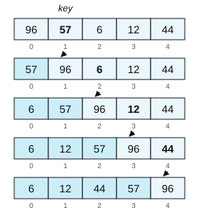
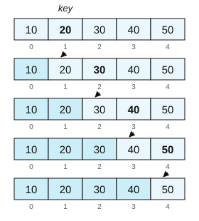
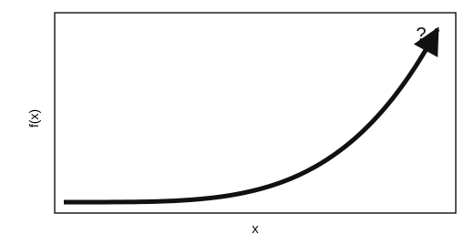

# Session 8: Time Complexity

*Introduction to Computing for the Social Sciences · lecture transcript*

> Companion text for lecture 8. Notation follows
> [the course conventions](00-Conventions.md).
>
> **Reading for this session:** Chapters 9 and 10 of Guttag, *Introduction to
> Computation and Programming Using Python* (2016). References at the end.

---

## Contents

<!-- MOTIVATION-TOC:BEGIN -->
0. [Motivating examples](#motivating-examples)
<!-- MOTIVATION-TOC:END -->
1. [The question](#1-the-question)
2. [Three kinds of complexity](#2-three-kinds-of-complexity)
3. [Why it matters: some numbers](#3-why-it-matters-some-numbers)
4. [Runtime analysis](#4-runtime-analysis)
5. [Best, average and worst case](#5-best-average-and-worst-case)
6. [Recursive algorithms: mergesort](#6-recursive-algorithms-mergesort)
7. [Graph algorithms: BFS](#7-graph-algorithms-bfs)
8. [Asymptotic behavior and O-notation](#8-asymptotic-behavior-and-o-notation)
9. [Using O-notation](#9-using-o-notation)
10. [Why this matters for us](#10-why-this-matters-for-us)
11. [Check yourself](#11-check-yourself)
12. [References](#12-references)

---

<!-- MOTIVATION-SECTION:BEGIN -->
## Motivating examples

Three candidate openings for this session, each a real situation the
material is the answer to. **One of these will be used in the lecture**;
the others are kept here because they are worth reading anyway.

<!-- MOTIVATION:M08-A:BEGIN -->
### A · It ran fine on the pilot

The pilot runs in four seconds. The full dataset is a thousand times larger.
How long will it take? The honest answer is that you cannot tell from the
four seconds, because that single measurement is compatible with wildly
different futures. If the cost grows linearly with $n$, one pass over the
data, then a thousand times more data means a thousand times more time, $4
\,\text{s} \times 1\,000 = 4\,000\,\text{s}$, about 67 minutes. If it grows
quadratically, a loop inside a loop over the same data, then a thousand times
more data means a million times more time, $4\,\text{s} \times 10^6 = 4
\times 10^6\,\text{s}$, about 46 days. If it grows as $n \log n$, as a sort
does, then about 90 minutes. And if it is exponential, the pilot was the
largest instance you will ever solve. Same code, same machine, same four
seconds. What separates 67 minutes from 46 days is not the speed of anything:
it is the shape of the growth, and that is a property you can read off the
code before running it at all.

This is why timing on a small case tells you so little, and why the advice
to optimize later if it turns out slow is bad advice. A constant-factor
optimization, whether better hardware, a faster language or more cores, buys
you a factor of ten or a hundred; going from quadratic to linear at $n =
10^6$ buys you a factor of a million. The first cannot substitute for the
second, and no amount of engineering rescues the wrong growth rate. There is
a second-order lesson in the arithmetic: the crossover is often past the
pilot. At $n = 1\,000$ a quadratic algorithm with a small constant can easily
beat a linear one with a large constant, which is exactly why the pilot did
not warn you. Asymptotic behavior is invisible at small $n$ by definition.

Section 4 of this session is about measuring the cost of an algorithm by
counting operations rather than seconds, so that the answer does not depend
on which laptop you used. Section 8 is about O-notation, the tool for saying
"linear", "quadratic" or "$n \log n$" precisely, and for justifying it from
the code. Section 5 is about the best, average and worst cases, because "how
long will it take" has three answers, and they can be very far apart.
Sections 3 and 9 put the growth rates side by side, which is the table to
keep: the difference between $\log n$, $n$, $n \log n$, $n^2$ and $2^n$ at
realistic sizes. The skill this session really teaches is to look at a piece
of code and say how its cost grows before you run it. After this session you
should be able to look at your own pilot script and predict which of the four
numbers above you are heading for.
<!-- MOTIVATION:M08-A:END -->
<!-- MOTIVATION:M08-B:BEGIN -->
### B · Two students, the same answer, 20 000× apart

This is a real exam question in this course, and both answers to it are
correct. You have a million posts and a list of 20 000 users, and you must
return only the posts written by users on the list. The first version is the
direct translation of the sentence:

```
For each post p:
      For each user u in users:
            If p.uid = u.uid
                  then keep p
```

The second version does the same thing with one preparatory step:

```
U ← ∅
For each user u in users:
      add u.uid to U                     # U is a hash set
For each post p:
      If p.uid ∈ U
            then keep p
```

They produce identical output, and if you only ever ran them on the seminar
example with 20 posts you would never tell them apart. Count the operations.
The first version makes $P \times U = 10^6 \times 2 \times 10^4 = 2 \times
10^{10}$ comparisons. The second makes $P + U \approx 10^6$ operations,
because each membership test computes the slot from the value and looks only
there. That is a factor of 20 000, and at a few million operations per second
in an interpreted language it is roughly an hour and a half against well
under a second.

Now the part that matters for how you read code: you did not have to run
anything to know this, you read the shapes. A loop inside a loop over a
different collection costs the product of the two sizes; this is the single
most common source of accidental quadratic behavior, and it appears every
time someone writes "for each X, look through the Y". Two loops one after
another cost the sum of the two sizes. Nested means multiply and sequential
means add, and that one rule, applied by eye, catches most complexity
problems in analysis code. It is what O-notation formalizes.

Section 4 of this session is about counting operations from the code, which
is exactly the reading above done carefully. Section 8 is about O-notation,
$O(P \cdot U)$ against $O(P + U)$, why constants and lower-order terms drop
out so that only the shape remains, and the rules for combining, where nested
loops multiply, sequential blocks add, and the largest term dominates.
Section 10 connects this to the data structures of session 3, so that "a hash
set makes membership $O(1)$" is a fact you can justify rather than remember.
The habit to build is that whenever you write a loop inside a loop, you ask
what the two collections are. If they are both large, you have just written
the slow version, and there is almost always a lookup table that turns it
into the fast one.
<!-- MOTIVATION:M08-B:END -->
<!-- MOTIVATION:M08-C:BEGIN -->
### C · Ten billion pages in a third of a second

Type a query into a search engine and the results come back in a fraction of
a second, from an index of more than ten billion pages. It is worth pausing
on how impossible that should be. Suppose the engine simply looked at every
page and checked whether it matched. At an implausibly generous one billion
pages per second, that is ten seconds per query, and only for the looking,
with no ranking, no relevance and no concurrent users. Real answers arrive in
about 0.3 seconds, for millions of simultaneous queries. Brute force is not
slow here; it is off by orders of magnitude that no hardware budget closes.
So the answer cannot be that the machines are fast. It has to be that the
procedure does not look at most of the data, and two ideas do the work, both
of them in this session.

The first is sub-linear search. A procedure whose cost grows like $\log n$
rather than $n$ touches a vanishing fraction of the data: $\log_2 (10^{10})
\approx 34$, a few dozen steps for ten billion items. The binary search of
session 3 is the elementary case, and a hash lookup, at $O(1)$, is better
still. The reason why logarithms matter so much in this course is exactly
this: $\log n$ barely grows, so a $\log n$ procedure scales to data that a
linear one cannot touch. The second is pre-computation. The search engine
does not answer your question from the web. It answers from an inverted
index, built in advance, which maps each word to the pages containing it.
Building it is enormously expensive and happens continuously, and the query
then costs a lookup rather than a scan. This is exactly the trade of session
7, where sorting is an investment, at industrial scale: pay a lot once, pay
almost nothing per query, and the arithmetic works because there are billions
of queries. The general form is the thing to take away: where you cannot
afford to compute the answer, arrange the data in advance so that the answer
is cheap to look up. That is the same move as building a hash set in session
3, sorting a codebook in session 7, and creating a database index in session
11, and this session gives you the vocabulary to say how much it buys.

Section 8 of this session is about O-notation, and sections 3 and 9 put the
growth rates side by side; the gap between $\log n$ and $n$ at $n = 10^{10}$
is the whole of the story above. Section 2 distinguishes time from memory
complexity, which is the other half of the trade: a pre-computed index is a
very large object, and someone pays for it. The framing to carry forward is
that complexity analysis is not about making slow code faster. It is about
knowing, in advance, which designs are possible at all at the size you care
about.
<!-- MOTIVATION:M08-C:END -->
---

<!-- MOTIVATION-SECTION:END -->
## 1. The question

Recall selection sort from session 7. For a list of length $n$ we search $n-1$
times for the minimum, over a list of decreasing length: the first search
looks at $n-1$ elements, the search after the first swap at $n-2$, the search
after the second swap at $n-3$, and so on. In total,

$$\sum_{i=1}^{n-1} i = \frac{(n-1)\,n}{2} \simeq \frac{n^2}{2}.$$

What does that mean in practice? Sorting a list of double the size takes four
times as long, and sorting a list of ten times the size takes a hundred times
as long. That last sentence is what this session is about. It is not a
statement about seconds, or about your laptop. It is a statement about how the
cost of an algorithm scales with the size of its input, and it is a property
of the algorithm itself.

---

## 2. Three kinds of complexity

The word complexity has three meanings in computer science. *Algorithmic
complexity* typically refers to the time complexity of a given algorithm, and
it depends on the particular implementation. *Memory complexity* is the memory
required during the calculation; mergesort, for example, needs a stack because
of the recursion plus a temporary second list, while quicksort in its optimal
implementation only requires the stack. *Problem complexity* is the minimal
effort needed to solve a problem, analyzed for typical cases; its
classification is independent of the specific algorithm but depends on the
algorithms known to solve the problem, and we will see more of it in session
9. Keep the three apart: "sorting is $n\log n$" is a claim about the problem,
"selection sort is $n^2$" is a claim about an algorithm, and "this Python
implementation takes 4 seconds" is a claim about an implementation on a
machine.

Outside computer science the word means something else, and the distinction
is worth having. A *complicated* system has many pieces with specific
functions and well-defined relationships; it has been carefully engineered or
designed. A *complex* system is composed of many particles that interact
following some forces or dynamics, and its behavior follows from natural
principles rather than from a design. A program with lots of lines of code,
functions and objects is complicated. A problem whose elements depend on each
other, such as a graph, can be complex, and the time required to solve it
depends both on that complexity and on the algorithms we have to solve it. We
care about all of this for two reasons: problem complexity decides whether we
can in principle solve a problem in a reasonable amount of time, and
algorithmic and memory complexity determine whether solutions are feasible to
implement with the memory and time actually available.

---

## 3. Why it matters: some numbers

Assume that a home computer executes $10^8$ operations per second and a
supercomputer $10^{12}$. Counting $n^2$ operations for selection sort and $n
\log_2 n$ for mergesort gives the following running times.

**Selection sort ($n^2$)**

| computer | thousand | million | billion |
|---|---|---|---|
| home | instant | 2.8 hours | 317 years |
| super | instant | 1 second | 1.6 weeks |

**Mergesort ($n \log n$)**

| computer | thousand | million | billion |
|---|---|---|---|
| home | instant | 0.2 sec | 5 min |
| super | instant | instant | instant |

Read these tables horizontally and vertically. Horizontally, for selection
sort, going from a thousand to a million items turns "instant" into hours, and
data size grows relentlessly in this field. Vertically, the supercomputer is
10 000 times faster, and for a billion items with selection sort it still
takes more than a week. Buying a bigger machine does not fix a bad algorithm,
while changing the algorithm turns 317 years into five minutes on the same
home computer. That is the single most important practical lesson of this
course.

A few more observations frame the rest of the session. Memory complexity and
time complexity can differ, and the trade-off between them is often relevant
in practice; memoization in session 6 bought time with space. Time complexity
varies in how it changes with $n$, since some functions rise slowly and then
sharply and others the reverse, which makes certain algorithms better for
small $n$ and others for large $n$. Depending on the data, complexity may
vary, so we distinguish worst-case, average-case and best-case complexity.
And the analysis is deliberately simplified: it is an approximate calculation
of the time complexity in terms of the input size $n$, it is machine
independent because it is a property of the algorithm, and time is measured
in the number of basic computer steps.

---

## 4. Runtime analysis

The runtime of an algorithm sums up the time units needed per instruction.
Primitive operations such as assignments, comparisons and arithmetic
operations count as one time unit each, a loop costs the number of iterations
times the time units per iteration, a method call costs the time units of
that method, and recursive calls cost the sum of all the calls inside the
recursion. The worked example of the lecture is selection sort in Python:

```python
def selectionsort(seq):
    for i in range(len(seq) - 1):        # 1
        k = i                            # 2
        for j in range(i+1, len(seq)):   # 3
            if seq[j] < seq[k]:          # 4
                k = j                    # 5
        seq[i], seq[k] = seq[k], seq[i]  # 6
    return seq
```

The first step is to count the primitive operations per line: line 1 has a
`range`, a length and an arithmetic operation, 3 time units; line 2 is an
assignment, 1 unit; line 3 has a `range`, an arithmetic operation and a
length, 3 units; line 4 is a comparison, 1 unit; line 5 an assignment, 1
unit; and line 6 a double assignment, 2 units. The second step is to count the
iterations: the outer loop runs a maximum of $n-1$ times, and the nested loop
a maximum of $n-1$ times. Note the words "a maximum of". The inner loop
actually runs $n-i$ times, which is at most $n-1$; replacing the exact count
with its maximum is an upper-bound approximation, and it is legitimate
precisely because we only care about growth. The third step puts it together,

$$\text{worst-case running time} = (n-1) \times \big(3 + 1 + (n-1)\times(3+1+1) + 2\big),$$

and the fourth step simplifies,

$$(n-1)\big(3 + 1 + 5(n-1) + 2\big) = 6n - 6 + 5(n-1)^2 = 5n^2 - 4n - 1.$$

The asymptotically dominant term is $n^2$, and constant terms and lower-order
terms influence the runtime only marginally as $n$ grows, which is what
O-notation formalizes. Look at what survived and what did not. The "3 time
units for `range`" was a guess, and it changed the constant 5 but not the
$n^2$. That robustness is the point: the analysis does not depend on details
we cannot know.

---

## 5. Best, average and worst case

The *average* running time is the mean over all possible problem cases,
assuming that they are all equally likely; the *worst-case* running time is
the maximum over any possible problem case, and the *best-case* running time
the minimum. For sorting, the problem cases are the possible initial orders of
the list. When selecting algorithms we should have an idea of the
distribution of problem cases in order to reason about the average, and we
mostly care about the average, but we should check that the worst case is not
too bad or too frequent. That last clause is the practical one. An algorithm
with a great average and a catastrophic worst case is fine until your data
happens to be the worst case, and, as with quicksort on sorted input, the
worst case is often exactly the input you get in practice.

Insertion sort is the example of an algorithm whose cases differ. Its
rationale is to sort incrementally by pushing each value to the position
where it belongs among the elements already sorted:

```
Procedure INSERTION-SORT(A, n)
Inputs:
      A: an array; n: the number of elements in A to sort
Result: the elements of A are sorted into nondecreasing order
For i = 2 to n:
      key ← A[i]; j ← i - 1
      While j > 0 and A[j] > key:
            A[j + 1] ← A[j]
            j ← j - 1
      A[j + 1] ← key
```



In the worst case the outer loop runs $n-1$ times and the inner `While` loop
runs backwards all the way to $j = 0$, that is, up to $n-1$ iterations, so the
worst-case running time is

$$(n-1) \times \big(2 + (n-1)\times(2+2) + 1\big),$$

which grows with $n^2$. In the best case, an already sorted list, the inner
loop always stops at its first test, because `A[j] > key` is immediately
false, so the running time grows with $n$. The average and the worst case are
$n^2$ and the best case is $n$. This is the contrast with selection sort,
which has no best case: its loops run to completion regardless of the input.
If your data is nearly sorted, which happens constantly with time series,
identifiers and log files, insertion sort is genuinely fast and selection
sort is not. The exercise of the lecture is to work out the best and
worst-case running times of quicksort.



---

## 6. Recursive algorithms: mergesort

For a recursive algorithm, the running time is defined recursively too.

```
Procedure MERGE-SORT(A, p, r)
If p ≥ r
      then return without doing anything
      else q ← ⌊(p + r) / 2⌋
            MERGE-SORT(A, p, q)
            MERGE-SORT(A, q + 1, r)
            MERGE(A, p, q, r)
```

Let $n$ be the length of $A$. The best case, a single element, takes one
operation; there are two recursive calls on arrays of length $n/2$; and the
call to MERGE with an array of length $n$ takes $c \cdot n$ steps for some
constant $c$. The running time therefore satisfies

$$T(n) = T(n/2) + T(n/2) + c \cdot n = 2 \cdot T(n/2) + c \cdot n,$$

and we can unroll the recurrence:

$$\begin{aligned}
T(n) &= 2 \cdot T(n/2) + c n\\
     &= 2\big[2 T(n/4) + c n/2\big] + cn = 2^2 T(n/4) + cn + cn\\
     &= 2^2\big[2 T(n/8) + cn/4\big] + cn + cn = 2^3 T(n/8) + cn + cn + cn\\
     &\;\;\vdots\\
     &= 2^k \cdot T(n/2^k) + k \cdot c \cdot n.
\end{aligned}$$

The recursion stops when the subarrays have one element, that is, when $n/2^k
= 1$, which means $k = \log_2 n$, and substituting with $T(1) = 1$ gives

$$T(n) = 2^{\log_2 n} + \log_2 n \cdot c \cdot n = n + c \cdot n \log_2 n.$$

The dominant term is $n \log_2 n$. There is an intuition behind the algebra
that is worth keeping: each level of the recursion does $cn$ work in total,
because every element is merged exactly once at that level, and there are
$\log_2 n$ levels, because halving $n$ that many times reaches 1. Multiply the
two.

---

## 7. Graph algorithms: BFS

For graphs, the input size needs two numbers, the number of vertices $|V|$
and the number of edges $|E|$. Recall breadth-first search from session 5:

```
Procedure BFS(G, s)
INITIALIZE-BFS(G, s)
Q ← ∅
ENQUEUE(Q, s)
While Q ≠ ∅:
      u ← DEQUEUE(Q)
      For each vertex v in neighbors(u):
            If color[v] = WHITE
                  then color[v] ← GRAY
                       d[v] ← d[u] + 1
                       π[v] ← u
                       ENQUEUE(Q, v)
      color[u] ← BLACK
```

We reason about it in two parts. We enqueue and dequeue each vertex exactly
once, because the color test makes sure of it, which contributes $|V|$. And
we check the adjacent nodes of each node; in an undirected graph stored as
adjacency lists, each edge appears in two lists, so each edge is examined
exactly twice, which contributes $2|E|$. The running time of BFS therefore
grows with $|V| + 2|E|$. Two lessons generalize. When the input has more than
one size parameter, the answer has more than one term. And the running time
depends on the representation: with an adjacency matrix, finding the
neighbors of a vertex means scanning a whole row, and BFS becomes $|V|^2$
instead of $|V| + |E|$, so the data structure choice of session 5 shows up
here as a difference in complexity.

The lecture's person for this session is Manuel Blum, born in Venezuela in
1938, professor of computer science at UC Berkeley and, since 2001, at
Carnegie Mellon University. He is one of the inventors of the linear-time
algorithm for finding the $k$-th smallest element of a list, together with
the calculation of its complexity, he received the Turing Award for his
contributions to the foundations of computational complexity theory and its
application to cryptography and program checking, and he is one of the
inventors of CAPTCHA as a Turing test. He is also known for being the mentor
of extraordinarily influential computer scientists: three Turing Award
winners, several winners of the Gödel and Knuth prizes, and about twenty
professors of computer science at top US universities.

---

## 8. Asymptotic behavior and O-notation

The *asymptotic behavior* of a function $f(x)$ describes its value towards
infinity: the values of $f(x)$ as $x \rightarrow \infty$ or $x \rightarrow
-\infty$, and the values of $x$ where $f(x) \rightarrow \infty$ or $f(x)
\rightarrow -\infty$.



O-notation, also called Big O notation, pronounced "big-oh", or Landau's
symbol, describes classes of functions with specific asymptotic properties.
The values of a given function, after some large value $n_0$, are always
larger than or equal to, or always smaller than or equal to, a given
function, and constants are not considered, or are absorbed into an
arbitrarily chosen pre-factor. There are three notations, of which $O$ is by
far the most used: $O$ refers to the upper bound, $\Omega$ to the lower bound
and $\Theta$ to the tight bound. Formally,

$$O(g(n)) = \{f(n) : \text{there exist positive constants } c \text{ and } n_0 \text{ such that } 0 \le f(n) \le c\,g(n) \text{ for all } n \ge n_0\},$$

and $\Omega$ and $\Theta$ are defined in the same way with $f(n) \ge c\,g(n)$
and with both inequalities at once. Read the definition slowly. It says to
ignore any finite prefix, which is the role of $n_0$, and to ignore any
constant factor, which is the role of $c$. What remains is the shape of the
growth.

Some conventions of use follow from this. People often write $f = O(g)$
instead of $f \in O(g)$; this is a tolerated abuse of notation, and we use it
too. The notation describes asymptotic upper, lower and exact bounds of a
function for large values, and the interest is in the dominant terms for
large values only, because more precise analyses are often very cumbersome
and unnecessary, constant factors may not be of interest, and a linear
acceleration is typically easy to achieve with new hardware. The goal is to
describe complexity through classes of functions; literally, "it cannot get
worse than $f$" if the complexity is $O(f)$. The general rules are to ignore
constants and to ignore lower-order terms, because certain terms dominate
others:

$$O(1) \subset O(\log n) \subset O(n) \subset O(n \log n) \subset O(n^2) \subset O(2^n) \subset O(n!).$$

So $5n^2 - 4n - 1$ is $O(n^2)$: drop the constant 5, drop $-4n$ and $-1$. To
show that $f \in O(g)$ you must produce $c$ and $n_0$. For $f(n) = 5n^2 - 4n -
1$ and $g(n) = n^2$, take $c = 5$ and $n_0 = 1$; then for all $n \ge 1$, $5n^2
- 4n - 1 \le 5n^2$, since $-4n - 1 < 0$. Note that the constants do not have
to be tight or clever: any pair that works proves the claim.

---

## 9. Using O-notation

Back to the tables of section 3, now labeled properly: selection sort is
$O(n^2)$ and mergesort is $O(n \log n)$, and using your laptop for an $O(n^2)$
algorithm is unfeasible for $n$ above a few million. O-notation is a
language for describing upper bounds on complexity, and here are some
sentences you should be able to produce and to read. The complexity of BFS is
$O(|V|+|E|)$, because the runtime of BFS grows with $|V| + 2|E|$ and the
constant 2 is dropped. Mergesort is much better than selection sort, because
the complexity of mergesort is $O(n \log n)$ and that of selection sort is
$O(n^2)$. Inverting matrices with the method taught in high school is
$O(n^3)$. Testing whether a number $k$ is prime with a brute-force algorithm,
dividing by all numbers up to $k-1$, is $O(k)$. And finding a Hamiltonian
path in a graph with a brute-force algorithm that explores all paths is
$O(|V|!)$. That last one is the setup for session 9. An $O(|V|!)$ algorithm
is not a slow algorithm; it is an algorithm that is useless for $|V| = 20$.

---

## 10. Why this matters for us

There are two reasons to care about complexity. The first is practical.
Algorithmic efficiency is often a precondition for doing any kind of data
analysis in a reasonable time, so understanding which implementation choices
make an algorithm inefficient is basic tradecraft. There are often simple
problems in day-to-day code that lead to massive slow-downs, the classic
being a lookup inside a loop that scans a list instead of hashing a
dictionary, as in session 3, which turns $O(n)$ into $O(n^2)$. And constants
can matter, so be aware of the best case and the average case and not only of
the worst case. The second reason is that a number of rather common social
science applications have very high problem complexity. Many of those
examples relate to graphs and networks, such as the traveling salesman problem
and graph isomorphism, which is exactly where session 9 goes next.

---

## 11. Check yourself

**1.** Simplify to O-notation: (a) 3n + 100, (b) n²/2 + 1000n, (c) 2ⁿ + n¹⁰⁰, (d) log(n²).

<details><summary>Answer</summary>

(a) $O(n)$, dropping the constant and the 3. (b) $O(n^2)$, because $1000n$ is
dominated for large $n$, even though it is bigger up to $n = 2000$. (c)
$O(2^n)$, because every exponential eventually beats every polynomial. (d)
$\log(n^2) = 2\log n$, so $O(\log n)$; note also that the base does not
matter, since $\log_a n$ and $\log_b n$ differ by a constant factor.

</details>

**2.** An algorithm takes 1 second on n = 1000. How long on n = 10 000 if it is O(n), O(n log n), O(n²), O(2ⁿ)?

<details><summary>Answer</summary>

For $O(n)$, 10 seconds. For $O(n\log n)$, $10 \times \frac{\log
10000}{\log 1000} \approx 13$ seconds. For $O(n^2)$, 100 seconds. For
$O(2^n)$, $2^{9000}$ times longer, a number with about 2700 digits; in other
words, never.

</details>

**3.** Is an O(n²) algorithm always slower than an O(n log n) one?

<details><summary>Answer</summary>

No, only eventually. O-notation says nothing about small $n$, and the
constants can differ by orders of magnitude. Insertion sort, $O(n^2)$, beats
mergesort for $n$ up to roughly 30 to 60, which is why real library sorts
switch to insertion sort on small subarrays.

</details>

**4.** Your code loops over a list of 10⁵ items and for each does `if x in mylist`. Why is it slow, and what is the fix?

<details><summary>Answer</summary>

`x in mylist` is a linear scan, so the total is $10^5 \times 10^5 = 10^{10}$
operations, that is, hours. Converting `mylist` to a `set` or a `dict` makes
each test a hash lookup, roughly $O(1)$, so the total drops to $10^5$, that
is, milliseconds. One line, five orders of magnitude. This is the single most
common performance bug in research code.

</details>

**5.** Prove that f(n) = 200n + 1 000 000 is in O(n³).

<details><summary>Answer</summary>

Take $c = 1$ and $n_0 = 101$. At $n = 101$, $n^3 = 1\,030\,301$ and $200n +
1\,000\,000 = 1\,020\,200$, so $f(n) \le n^3$ holds, and since $n^3 - 200n -
1\,000\,000$ is increasing for $n \ge 9$ (its derivative $3n^2 - 200$ is
positive there), it holds for all $n \ge 101$. The claim is true: $O$ is an
upper bound, and a loose upper bound is still a valid one. The tight answer
is $\Theta(n)$.

</details>

---

## 12. References

- **Guttag, J. V. (2016).** *Introduction to Computation and Programming Using
  Python*, 2nd ed., MIT Press, chapters 9 and 10. The reading for this session.
- **Cormen, T. H., Leiserson, C. E., Rivest, R. L. & Stein, C. (2009).**
  *Introduction to Algorithms*, 3rd ed., chapter 3 (growth of functions) and
  chapter 4 (recurrences and the master theorem, the general form of the
  mergesort calculation in section 6). Source of the formal $O$, $\Omega$ and
  $\Theta$ definitions.
- **Cormen, T. H. (2013).** *Algorithms Unlocked*, chapters 1 and 2.
- **Knuth, D. E. (1976).** "Big Omicron and big Omega and big Theta". *ACM
  SIGACT News* 8(2), 18–24. Where the modern convention for the three symbols
  was fixed.
- **Blum, M.,** profile and academic lineage:
  <https://www.technologyreview.com/2023/10/24/1081478/manuel-blum-theoretical-computer-science-turing-award-academic-advisor/>
- **Python time complexity of built-in operations:**
  <https://wiki.python.org/moin/TimeComplexity>. The practical reference behind
  check-yourself question 4.
- **Big-O complexity chart:** <https://www.bigocheatsheet.com/>
