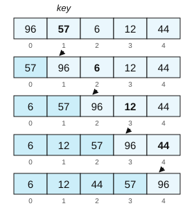
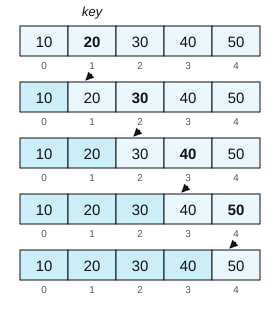
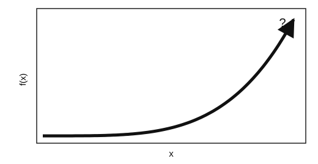

# Session 8: Time Complexity

<style>
figure, .figure, .float { margin: 1.4em 0 1.8em 0; }
figure img, .float img { display: block; max-width: 100%; }
figcaption, .figcaption, .figure p.caption { margin-top: 0.3em; font-size: 0.88em; color: #555; }
details { margin: -0.5em 0 2.2em 0; }
</style>

*Introduction to Computing for the Social Sciences · lecture transcript*

**Reading for this session:** Chapters 9 and 10 of Guttag, *Introduction to
Computation and Programming Using Python* (2016). References at the end.

---

## Contents

1. [Complexity](#complexity)
2. [Runtime analysis](#runtime-analysis)
3. [O-notation](#o-notation)

---

<!-- MOTIVATION-SECTION:BEGIN -->
## Motivating examples

<!-- MOTIVATION:M08-A:BEGIN -->
### A · It ran fine on the pilot

Imagine that your script processes a pilot dataset in four seconds and that
the full dataset is a thousand times larger. How long will the full run take?
You cannot tell from the four seconds alone, because that single measurement
is compatible with very different running times. If the cost grows linearly
with $n$, for example because the script makes one pass over the data, then a
thousand times more data means a thousand times more time, i.e. $4
\,\text{s} \times 1{,}000 = 4{,}000\,\text{s}$ or about 67 minutes. If the
cost grows quadratically, for example because the script has a loop inside a
loop over the same data, then a thousand times more data means a million times
more time, i.e. $4\,\text{s} \times 10^6 = 4 \times 10^6\,\text{s}$ or about
46 days. If the cost grows as $n \log n$, as the cost of a sort does, the full
run takes about 90 minutes. If the cost grows exponentially, the full run will
not finish and the pilot was about the largest case that you can solve. In all
four cases the code, the machine and the four seconds are the same. The
difference between 67 minutes and 46 days comes from how the cost grows with
the size of the data, and you can find that out from the code before running
it.

This is why timing a small case tells you so little and why the advice to
optimize later if the code turns out to be slow is bad advice. A
constant-factor optimization, for example better hardware, a faster language
or more cores, makes the code ten or a hundred times faster. Going from
quadratic to linear at $n = 10^6$ makes it a million times faster. Therefore
the first cannot replace the second and no amount of engineering compensates
for the wrong growth rate. The pilot often does not warn you either, because
the growth rate is not yet visible at small sizes. For example, at $n =
1{,}000$ a quadratic algorithm with a small constant can easily be faster than
a linear algorithm with a large constant, and the linear one only wins when
$n$ gets larger.

In this session you will learn to measure the cost of an algorithm by counting
operations instead of seconds, so that the answer does not depend on which
laptop you used. You will learn O-notation, which is the tool to say "linear",
"quadratic" or "$n \log n$" precisely and to justify it from the code. We will
also learn about the best, average and worst cases, because the question of
how long a program takes has three answers that can be very far apart, and we
will compare the growth rates $\log n$, $n$, $n \log n$, $n^2$ and $2^n$ at
realistic sizes. After this session you should be able to look at your own
pilot script and predict which of the four running times above you should
expect.

<!-- MOTIVATION:M08-A:END -->
<!-- MOTIVATION:M08-B:BEGIN -->
### B · Two students, the same answer, 20,000× apart

Two students get the same task. They have a million posts and a list of 20,000
users and they must return only the posts written by users on the list. Both
of their answers are correct. The first student translates the sentence of
the task directly into two loops:

```
For each post p:
      For each user u in users:
            If p.uid = u.uid
                  then keep p
```

The second student adds one preparatory step, which is to store the user ids
in a hash set:

```
U ← ∅
For each user u in users:
      add u.uid to U                     # U is a hash set
For each post p:
      If p.uid ∈ U
            then keep p
```

Both versions produce identical output, and if you only ran them on a small
example with 20 posts you would not notice any difference between them.
However, we can count the operations. The first version makes $P \times U =
10^6 \times 2 \times 10^4 = 2 \times 10^{10}$ comparisons. The second makes
$P + U \approx 10^6$ operations, because each membership test computes the
slot from the value and looks only there. The first version therefore does
20,000 times more work. At a few million operations per second in an
interpreted language, this is roughly an hour and a half against well under a
second.

You did not have to run anything to know this, because you can see it in the
structure of the code. A loop inside a loop over a different collection costs
the product of the two sizes. This is the most common source of accidental
quadratic behavior and it appears every time someone writes "for each X, look
through the Y". Two loops one after the other cost the sum of the two sizes.
In short, nested loops multiply and sequential loops add. This one rule
catches most complexity problems in analysis code and O-notation formalizes
it.

In this session you will learn to count operations from the code, which is the
reading above done carefully. You will learn to use O-notation to write $O(P
\cdot U)$ against $O(P + U)$, why constants and lower-order terms drop out,
and the rules for combining costs, i.e. nested loops multiply, sequential
blocks add and the largest term dominates. We will also connect this to the
Data Structures session, so that you can justify that a hash set makes
membership $O(1)$ instead of just remembering it. For your own code, whenever
you write a loop inside a loop, ask yourself what the two collections are. If
both are large, you have written the slow version and there is usually a
lookup table that turns it into the fast one.

<!-- MOTIVATION:M08-B:END -->
<!-- MOTIVATION:M08-C:BEGIN -->
### C · Ten billion pages in a third of a second

When you type a query into a search engine, the results come back in a
fraction of a second from an index of more than ten billion pages. Suppose
that the engine simply looked at every page and checked whether it matched.
Even at a very generous one billion pages per second, this would take ten
seconds per query only for looking at the pages, with no ranking, no relevance
and no other users. Real answers arrive in about 0.3 seconds for millions of
simultaneous queries. Brute force is therefore too slow by orders of magnitude
and no hardware budget can make up for that. The explanation cannot be that
the machines are fast. Instead, the procedure does not look at most of the
data, and it achieves that with two ideas that we will learn in this session.

The first idea is sub-linear search. A procedure whose cost grows like $\log
n$ instead of $n$ looks at a very small fraction of the data. For example,
$\log_2 (10^{10}) \approx 34$, i.e. a few dozen steps are enough for ten
billion items. The binary search of the Data Structures session is the
simplest case and a hash lookup is even better at $O(1)$. Logarithms matter so
much in this course because $\log n$ barely grows, so a $\log n$ procedure
scales to data sizes for which a linear one is too slow.

The second idea is pre-computation. The search engine does not answer your
question from the web. Instead, it answers from an inverted index that was
built in advance and that maps each word to the pages containing it. Building
the index is very expensive and happens continuously, but then each query
costs a lookup instead of a scan. This is the same trade as in the Sorting
Algorithms session, where sorting is an investment that makes later searches
cheap. You pay a lot once and almost nothing per query, which pays off because
there are billions of queries. More generally, where you cannot afford to
compute the answer, you can arrange the data in advance so that the answer is
cheap to look up. We do the same when we build a hash set in the Data
Structures session, sort a codebook in the Sorting Algorithms session and
create a database index in the Databases session.

In this session you will learn O-notation and compare the growth rates of
common functions. The gap between $\log n$ and $n$ at $n = 10^{10}$ explains
the example above. We will also distinguish time from memory complexity,
because a pre-computed index is a very large object that someone has to store
and pay for. Complexity analysis is not only about making slow code faster. It
also tells you in advance which designs are possible at all at the size that
you care about.

<!-- MOTIVATION:M08-C:END -->

---

<!-- MOTIVATION-SECTION:END -->
## 1. The question {#complexity}
Recall selection sort from the Sorting Algorithms session. For a list of
length $n$ we search $n-1$ times for the minimum over a list of decreasing
length. The first search looks at $n-1$ elements, the search after the first
swap looks at $n-2$, the search after the second swap looks at $n-3$, and so
on. In total, the number of elements that we look at is

$$\sum_{i=1}^{n-1} i = \frac{(n-1)\,n}{2} \simeq \frac{n^2}{2}.$$

What does that mean in practice? Sorting a list of double the size takes four
times as long, and sorting a list of ten times the size takes a hundred times
as long. This session is about statements of this kind. They do not say
anything about seconds or about your laptop. Instead, they say how the cost of
an algorithm scales with the size of its input, which is a property of the
algorithm itself.

---

## 2. Three kinds of complexity

The word complexity has three meanings in computer science:

- *Algorithmic complexity* typically refers to the time complexity of a given
  algorithm. It depends on the particular implementation.
- *Memory complexity* is the memory required during the calculation. For
  example, mergesort needs a stack because of the recursion plus a temporary
  second list, while quicksort in its optimal implementation only requires the
  stack.
- *Problem complexity* is the minimal effort needed to solve a problem,
  analyzed for typical cases. Its classification is independent of the
  specific algorithm but it depends on the algorithms known to solve the
  problem. We will learn more about it in the Theoretical Computer Science
  session.

It is important to keep the three apart. For example, "sorting is $n\log n$"
is a claim about the problem, "selection sort is $n^2$" is a claim about an
algorithm, and "this Python implementation takes 4 seconds" is a claim about
an implementation on a machine.

Outside computer science the word complexity has a more general meaning, which
we can see by comparing complicated and complex systems. A *complicated*
system has many pieces with specific functions and well-defined relationships,
and it has been carefully engineered or designed. A *complex* system is
composed of many particles that interact following some forces or dynamics,
and its behavior follows from natural principles instead of from a design. For
example, a program with lots of lines of code, functions and objects is
complicated. A problem whose elements depend on each other, such as a graph,
can be complex, and the time required to solve it depends both on that
complexity and on the algorithms that we have to solve it.

We care about complexity for two reasons. First, problem complexity decides
whether we can in principle solve a problem in a reasonable amount of time.
Second, algorithmic and memory complexity determine whether solutions are
feasible to implement with the memory and time that are actually available.

---

## 3. Why it matters: some numbers

Assume that a home computer executes $10^8$ operations per second and a
supercomputer $10^{12}$. If we count $n^2$ operations for selection sort and
$n \log_2 n$ for mergesort, we get the following running times.

**Selection sort ($n^2$)**

| computer | thousand | million | billion |
|---|---|---|---|
| home | instant | 2.8 hours | 317 years |
| super | instant | 1 second | 1.6 weeks |

**Mergesort ($n \log n$)**

| computer | thousand | million | billion |
|---|---|---|---|
| home | instant | 0.2 sec | 5 min |
| super | instant | instant | instant |

We can read these tables horizontally and vertically. Horizontally, going from
a thousand to a million items with selection sort turns "instant" into hours,
and the size of the data that we work with keeps growing. Vertically, the
supercomputer is 10,000 times faster but it still takes more than a week to
sort a billion items with selection sort. Buying a bigger machine does not fix
a bad algorithm, while changing the algorithm turns 317 years into five
minutes on the same home computer. This is one of the most important practical
lessons of this course. You can measure the same effect yourself in the
[Python examples notebook of this session](https://github.com/dgarcia-eu/ICSS/blob/main/PythonExamples/Examples08-TimeComplexity.ipynb),
which times three solutions of one problem and extrapolates them to large
data.

A few more observations are useful for the rest of the session:

- **Memory and time.** Memory complexity and time complexity can differ, and
  the trade-off between them is often relevant in practice. For example,
  memoization in the Recursion session used more memory to save time. In this
  session we focus on time complexity.
- **Growth with $n$.** Time complexity varies in how it changes with $n$. Some
  functions rise slowly and then sharply while others do the reverse, which
  makes certain algorithms better for small $n$ and others for large $n$.
- **Dependence on the data.** Complexity may vary depending on the data, so we
  distinguish worst-case, average-case and best-case complexity.
- **Simplified analysis.** The analysis is deliberately simplified. It is an
  approximate calculation of the time complexity in terms of the input size
  $n$. It is machine independent because it is a property of the algorithm,
  and time is measured in the number of basic computer steps.

---

## 4. Runtime analysis {#runtime-analysis}
The runtime of an algorithm sums up the time units needed per instruction. We
count them as follows:

- **Primitive operations** such as assignments, comparisons and arithmetic
  operations count as one time unit each.
- **Loops** cost the number of iterations times the time units per iteration.
- **Method calls** cost the time units of that method.
- **Recursive calls** cost the sum of all the calls inside the recursion.

Let's apply these rules to selection sort in Python:

```python
def selectionsort(seq):
    for i in range(len(seq) - 1):        # 1
        k = i                            # 2
        for j in range(i+1, len(seq)):   # 3
            if seq[j] < seq[k]:          # 4
                k = j                    # 5
        seq[i], seq[k] = seq[k], seq[i]  # 6
    return seq
```

We analyze the code in four steps. First, we count the primitive operations
per line. Line 1 has a `range`, a length and an arithmetic operation, which
are 3 time units. Line 2 is an assignment, i.e. 1 unit. Line 3 has a `range`,
an arithmetic operation and a length, which are 3 units. Line 4 is a
comparison (1 unit), line 5 is an assignment (1 unit) and line 6 is a double
assignment (2 units).

Second, we count the iterations. The outer loop runs a maximum of $n-1$ times
and the nested loop also runs a maximum of $n-1$ times. We say "a maximum of"
because the inner loop actually runs $n-i$ times, which is at most $n-1$.
Replacing the exact count with its maximum is an upper-bound approximation,
which is acceptable because we only care about how the running time grows.

Third, we put the counts together:

$$\text{worst-case running time} = (n-1) \times \big(3 + 1 + (n-1)\times(3+1+1) + 2\big)$$

Finally, we simplify the expression:

$$(n-1)\big(3 + 1 + 5(n-1) + 2\big) = 6n - 6 + 5(n-1)^2 = 5n^2 - 4n - 1$$

The asymptotically dominant term is $n^2$. Constant terms and lower-order
terms influence the runtime only marginally as $n$ grows, which is what
O-notation formalizes. Note that the "3 time units for `range`" was a guess. A
different guess would change the constant 5 but not the $n^2$, so the result
of the analysis does not depend on details that we cannot know.

---

## 5. Best, average and worst case

The *average* running time is the mean over all possible problem cases,
assuming that they are all equally likely. The *worst-case* running time is
the maximum over any possible problem case and the *best-case* running time is
the minimum. For sorting, the problem cases are the possible initial orders of
the list. When we select an algorithm we should have an idea of the
distribution of problem cases in order to reason about the average running
time. We mostly care about the average but we should check that the worst case
is not too bad or too frequent. An algorithm with a great average and a very
bad worst case works well until your data happens to be the worst case. For
example, the worst case of quicksort with the last element as pivot is an
already sorted list, which is an input that often appears in practice.

Insertion sort is an example of an algorithm whose cases differ. Its rationale
is to sort incrementally by pushing each value to the position where it
belongs among the elements that are already sorted:

```
Procedure INSERTION-SORT(A, n)
Inputs:
      A: an array; n: the number of elements in A to sort
Result: the elements of A are sorted into nondecreasing order
For i = 2 to n:
      key ← A[i]; j ← i - 1
      While j > 0 and A[j] > key:
            A[j + 1] ← A[j]
            j ← j - 1
      A[j + 1] ← key
```



In the worst case the outer loop runs $n-1$ times and the inner `While` loop
runs backwards all the way to $j = 0$, i.e. up to $n-1$ iterations. The
worst-case running time is therefore

$$(n-1) \times \big(2 + (n-1)\times(2+2) + 1\big)$$

This expression grows with $n^2$. The best case is an already sorted list. There the
inner loop always stops at its first test because `A[j] > key` is immediately
false, so the running time grows with $n$. In summary, the average and the
worst case of insertion sort are $n^2$ and the best case is $n$. Selection
sort is different because its loops run to completion regardless of the input,
so its best case is $n^2$ too. If your data is nearly sorted, which often
happens with time series, identifiers and log files, insertion sort is fast
and selection sort is not.



As an exercise, what are the best and worst-case running times of quicksort?
You can also see the three cases in practice in the Python examples notebook
of this session, which times the best, average and worst case of a linear
search on the same list.

---

## 6. Recursive algorithms: mergesort

For a recursive algorithm, the running time is also defined recursively. We
can see this with mergesort:

```
Procedure MERGE-SORT(A, p, r)
If p ≥ r
      then return without doing anything
      else q ← ⌊(p + r) / 2⌋
            MERGE-SORT(A, p, q)
            MERGE-SORT(A, q + 1, r)
            MERGE(A, p, q, r)
```

Let $n$ be the length of $A$. The best case is a single element and takes one
operation. Otherwise there are two recursive calls on arrays of length $n/2$,
and the call to MERGE with an array of length $n$ takes $c \cdot n$ steps for
some constant $c$. The running time therefore satisfies

$$T(n) = T(n/2) + T(n/2) + c \cdot n = 2 \cdot T(n/2) + c \cdot n$$

We can unroll this recurrence by replacing $T$ on the right side again and
again:

$$\begin{aligned}
T(n) &= 2 \cdot T(n/2) + c n\\
     &= 2\big[2 T(n/4) + c n/2\big] + cn = 2^2 T(n/4) + cn + cn\\
     &= 2^2\big[2 T(n/8) + cn/4\big] + cn + cn = 2^3 T(n/8) + cn + cn + cn\\
     &\;\;\vdots\\
     &= 2^k \cdot T(n/2^k) + k \cdot c \cdot n.
\end{aligned}$$

The recursion stops when the subarrays have one element, i.e. when $n/2^k =
1$, which means $k = \log_2 n$. Substituting this $k$ and $T(1) = 1$ gives

$$T(n) = 2^{\log_2 n} + \log_2 n \cdot c \cdot n = n + c \cdot n \log_2 n$$

The dominant term is $n \log_2 n$. There is also an intuition behind the
algebra. Each level of the recursion does $cn$ work in total because every
element is merged exactly once at that level, and there are $\log_2 n$ levels
because halving $n$ that many times reaches 1. Multiplying the work per level
by the number of levels gives $c \cdot n \log_2 n$.

---

## 7. Graph algorithms: BFS

For graphs, the input size needs two numbers, namely the number of vertices
$|V|$ and the number of edges $|E|$. Recall breadth-first search from the
Algorithms session:

```
Procedure BFS(G, s)
INITIALIZE-BFS(G, s)
Q ← ∅
ENQUEUE(Q, s)
While Q ≠ ∅:
      u ← DEQUEUE(Q)
      For each vertex v in neighbors(u):
            If color[v] = WHITE
                  then color[v] ← GRAY
                       d[v] ← d[u] + 1
                       π[v] ← u
                       ENQUEUE(Q, v)
      color[u] ← BLACK
```

We reason about its running time in two parts. First, we enqueue and dequeue
each vertex exactly once because the color test makes sure of it, which
contributes $|V|$. Second, we check the adjacent nodes of each node. In an
undirected graph stored as adjacency lists each edge appears in two lists, so
each edge is examined exactly twice, which contributes $2|E|$. The running
time of BFS therefore grows with $|V| + 2|E|$.

We can learn two more general things from this example. When the input has
more than one size parameter, the answer has more than one term. In addition,
the running time depends on the representation. With an adjacency matrix,
finding the neighbors of a vertex means scanning a whole row, so BFS becomes
$|V|^2$ instead of $|V| + |E|$. The choice of data structure that we discussed
in the Algorithms session therefore appears here as a difference in
complexity.

A computer scientist who shaped the study of complexity is Manuel Blum. He was
born in Venezuela in 1938 and has been a professor of computer science at UC
Berkeley and, since 2001, at Carnegie Mellon University. He is one of the
inventors of the linear-time algorithm for finding the $k$-th smallest element
of a list, together with the calculation of its complexity. He received the
Turing Award for his contributions to the foundations of computational
complexity theory and its application to cryptography and program checking,
and he is one of the inventors of CAPTCHA as a Turing test. He is also known
for being the mentor of very influential computer scientists, namely three
Turing Award winners, several winners of the Gödel and Knuth prizes, and about
twenty professors of computer science at top US universities.

---

## 8. Asymptotic behavior and O-notation {#o-notation}
The *asymptotic behavior* of a function $f(x)$ describes its value towards
infinity. This includes the values of $f(x)$ as $x \rightarrow \infty$ or $x
\rightarrow -\infty$ and the values of $x$ where $f(x) \rightarrow \infty$ or
$f(x) \rightarrow -\infty$.



O-notation describes classes of functions with specific asymptotic properties.
It is also called Big O notation, pronounced "big-oh", or Landau's symbol. The
idea is that the values of a given function, after some large value $n_0$, are
always larger than or equal to, or always smaller than or equal to, the values
of another function. Constants are not considered or are absorbed into an
arbitrarily chosen pre-factor. There are three notations, where $O$ refers to
the upper bound, $\Omega$ to the lower bound and $\Theta$ to the tight bound.
Of the three, $O$ is by far the most used. Formally,

$$O(g(n)) = \{f(n) : \text{there exist positive constants } c \text{ and } n_0 \text{ such that } 0 \le f(n) \le c\,g(n) \text{ for all } n \ge n_0\}$$

$\Omega$ and $\Theta$ are defined in the same way, with $f(n) \ge c\,g(n)$ for
$\Omega$ and with both inequalities at once for $\Theta$. The definition says
two things. We ignore any finite prefix, which is the role of $n_0$, and we
ignore any constant factor, which is the role of $c$. What remains is how fast
the function grows.

Some conventions of use follow from this definition. People often write $f =
O(g)$ instead of $f \in O(g)$, which is a tolerated abuse of notation that we
use too. The notation describes asymptotic upper, lower and exact bounds of a
function for large values. We are interested in the dominant terms for large
values only, for three reasons. More precise analyses are often very
cumbersome and unnecessary, constant factors may not be of interest, and a
linear acceleration is typically easy to achieve with new hardware. The goal
is to describe complexity through classes of functions. If the complexity is
$O(f)$, this literally means that "it cannot get worse than $f$". The general
rules are to ignore constants and to ignore lower-order terms, because certain
terms dominate others in the following order.

$$O(1) \subset O(\log n) \subset O(n) \subset O(n \log n) \subset O(n^2) \subset O(2^n) \subset O(n!)$$

For example, $5n^2 - 4n - 1$ is $O(n^2)$ because we drop the constant 5 and
the lower-order terms $-4n$ and $-1$. To show formally that $f \in O(g)$ you
must give values of $c$ and $n_0$. For $f(n) = 5n^2 - 4n - 1$ and $g(n) =
n^2$, we can take $c = 5$ and $n_0 = 1$. Then $5n^2 - 4n - 1 \le 5n^2$ for all
$n \ge 1$, since $-4n - 1 < 0$. The constants do not have to be the smallest
possible ones, because any pair that works proves the claim.

---

## 9. Using O-notation

Let's go back to the tables of running times above, which we can now label
properly. Selection sort is $O(n^2)$ and mergesort is $O(n \log n)$. Using
your laptop for an $O(n^2)$ algorithm is unfeasible for $n$ above a few
million. O-notation is a language to describe upper bounds on complexity. Here
are some sentences in that language that you should be able to write and to
read:

- **BFS.** The complexity of BFS is $O(|V|+|E|)$, because the runtime of BFS
  grows with $|V| + 2|E|$ and the constant 2 is dropped.
- **Sorting.** Mergesort is much better than selection sort, because the
  complexity of mergesort is $O(n \log n)$ and that of selection sort is
  $O(n^2)$.
- **Matrices.** Inverting matrices with the method taught in high school is
  $O(n^3)$.
- **Prime numbers.** Testing whether a number $k$ is prime with a brute-force
  algorithm that divides by all numbers up to $k-1$ is $O(k)$.
- **Hamiltonian paths.** Finding a Hamiltonian path in a graph with a
  brute-force algorithm that explores all paths is $O(|V|!)$.

An $O(|V|!)$ algorithm is not just slow. It is already useless for a graph of
$|V| = 20$ vertices, because $20!$ is more than $10^{18}$ paths. We will come
back to problems of this kind in the Theoretical Computer Science session.

---

## 10. Why this matters for us

There are two reasons to care about complexity. The first reason is practical.
Algorithmic efficiency is often a precondition for doing any kind of data
analysis in a reasonable time, so you need to understand which implementation
choices make an algorithm inefficient. There are often simple problems in
day-to-day code that lead to massive slow-downs. A classic example is a lookup
inside a loop that scans a list instead of using a dictionary as in the Data
Structures session, which turns $O(n)$ into $O(n^2)$. Constants can also
matter, so be aware of the best case and the average case and not only of the
worst case.

The second reason is that a number of rather common social science
applications have very high problem complexity. Many of those examples relate
to graphs and networks, such as the traveling salesman problem and graph
isomorphism. We will learn about such problems in the Theoretical Computer
Science session.

---

## 11. Why does this matter? Practical Python examples

Check the [practical Python examples in this Jupyter notebook](https://github.com/dgarcia-eu/ICSS/blob/main/PythonExamples/Examples08-TimeComplexity.ipynb).
There, you will see three ways to find duplicate ids timed on samples of
growing size, how to read their growth rates from a plot and extrapolate them
to a billion rows, and how the same linear search has different best, average
and worst-case running times.

---

## 12. Check yourself

**1.** Simplify to O-notation: (a) 3n + 100, (b) n²/2 + 1,000n, (c) 2ⁿ + n¹⁰⁰, (d) log(n²).

<details><summary>Answer</summary>

(a) $O(n)$, because we drop the constant 100 and the factor 3. (b) $O(n^2)$,
because $1{,}000n$ is dominated for large $n$ even though it is bigger up to
$n = 2{,}000$. (c) $O(2^n)$, because every exponential eventually beats every
polynomial. (d) $\log(n^2) = 2\log n$, so it is $O(\log n)$. The base of the
logarithm does not matter either, since $\log_a n$ and $\log_b n$ differ by a
constant factor.

</details>

**2.** An algorithm takes 1 second on n = 1,000. How long does it take on n = 10,000 if it is O(n), O(n log n), O(n²), O(2ⁿ)?

<details><summary>Answer</summary>

For $O(n)$ it takes 10 seconds. For $O(n\log n)$ it takes $10 \times
\frac{\log 10{,}000}{\log 1{,}000} \approx 13$ seconds. For $O(n^2)$ it takes
100 seconds. For $O(2^n)$ it takes $2^{9{,}000}$ times longer, which is a
number with about 2,700 digits, so in practice it never finishes.

</details>

**3.** Is an O(n²) algorithm always slower than an O(n log n) one?

<details><summary>Answer</summary>

No, only for large enough $n$. O-notation says nothing about small $n$ and the
constants can differ by orders of magnitude. For example, insertion sort is
$O(n^2)$ but it is faster than mergesort for $n$ up to roughly 30 to 60, which
is why real library sorts switch to insertion sort on small subarrays.

</details>

**4.** Your code loops over a list of 10⁵ items and for each does `if x in mylist`. Why is it slow, and what is the fix?

<details><summary>Answer</summary>

`x in mylist` is a linear scan, so the total is $10^5 \times 10^5 = 10^{10}$
operations, which takes hours. Converting `mylist` to a `set` or a `dict`
makes each test a hash lookup of roughly $O(1)$, so the total drops to $10^5$
operations, which takes milliseconds. A change of one line saves five orders
of magnitude. This is one of the most common performance bugs in research
code.

</details>

**5.** Prove that f(n) = 200n + 1,000,000 is in O(n³).

<details><summary>Answer</summary>

Take $c = 1$ and $n_0 = 101$. At $n = 101$ we have $n^3 = 1{,}030{,}301$ and
$200n + 1{,}000{,}000 = 1{,}020{,}200$, so $f(n) \le n^3$ holds. Since $n^3 -
200n - 1{,}000{,}000$ is increasing for $n \ge 9$, because its derivative
$3n^2 - 200$ is positive there, the inequality holds for all $n \ge 101$. The
claim is true because $O$ is an upper bound and a loose upper bound is still a
valid one. The tight bound is $\Theta(n)$.

</details>

---

## 13. References

- **Guttag, J. V. (2016).** *Introduction to Computation and Programming Using
  Python*, 2nd ed., MIT Press, chapters 9 and 10. The reading for this session.
- **Cormen, T. H., Leiserson, C. E., Rivest, R. L. & Stein, C. (2009).**
  *Introduction to Algorithms*, 3rd ed., chapter 3 (growth of functions) and
  chapter 4 (recurrences and the master theorem, the general form of the
  mergesort calculation above). Source of the formal $O$, $\Omega$ and
  $\Theta$ definitions.
- **Cormen, T. H. (2013).** *Algorithms Unlocked*, chapters 1 and 2.
- **Knuth, D. E. (1976).** "Big Omicron and big Omega and big Theta". *ACM
  SIGACT News* 8(2), 18–24. Where the modern convention for the three symbols
  was fixed.
- **Blum, M.,** profile and academic lineage:
  <https://www.technologyreview.com/2023/10/24/1081478/manuel-blum-theoretical-computer-science-turing-award-academic-advisor/>
- **Python time complexity of built-in operations:**
  <https://wiki.python.org/moin/TimeComplexity>. The practical reference behind
  check-yourself question 4.
- **Big-O complexity chart:** <https://www.bigocheatsheet.com/>
