# Session 9: Theoretical Computer Science

<style>
figure, .figure, .float { margin: 1.4em 0 1.8em 0; }
figure img, .float img { display: block; max-width: 100%; }
figcaption, .figcaption, .figure p.caption { margin-top: 0.3em; font-size: 0.88em; color: #555; }
details { margin: -0.5em 0 2.2em 0; }
</style>

*Introduction to Computing for the Social Sciences · lecture transcript*

**Reading for this session:** Chapter 1 of Sipser, *Introduction to the Theory
of Computation* (2012), chapters 6 and 12 of Evans, *Introduction to Computing*
(2011), and chapter 10 of Cormen, *Algorithms Unlocked* (2013). References at
the end.

---

## Contents

1. [Finite-state automata](#automata)
2. [Formal languages and grammars](#formal-languages)
3. [Turing machines](#turing-machines)
4. [Computability](#computability)
5. [Complexity classes](#complexity-classes)

---

<!-- MOTIVATION-SECTION:BEGIN -->
## Motivating examples

<!-- MOTIVATION:M09-A:BEGIN -->
### A · The regular expression that took down a large part of the web

On 2 July 2019, Cloudflare pushed a routine update to its firewall rules.
Cloudflare is a company whose servers handle the traffic of a large fraction
of the world's websites. One of the new rules was a regular expression
intended to detect malicious JavaScript. Within seconds, CPU usage across the
entire global network reached 100% and a substantial share of the web
returned errors for 27 minutes. In simplified form, the pattern contained the
fragment `.*(?:.*=.*)`, i.e. a repetition nested inside a repetition. On
certain inputs, a backtracking matcher has to try an exponential number of
ways to split the input between the two repetitions before it can conclude
that there is no match. This failure is common enough to have a name,
catastrophic backtracking, and a vulnerability category called ReDoS.

The explanation of this outage is theoretical rather than an engineering
mistake. In the mathematical sense, a regular expression describes exactly
what a finite-state automaton can recognize. A finite-state automaton is a
machine with finitely many states that reads the input once from left to
right and has no memory beyond its current state. The cost of running such a
machine is always linear in the length of the input, and the machine cannot
backtrack because it does not store anything that it could go back to.
However, the regular expression engines of most programming languages are not
that machine. They implement extra features such as backreferences and
lookahead, which go beyond regular languages, and they are built on
backtracking search instead of an automaton, which is where the exponential
cost comes from. Engines built as true automata, for example Go's `regexp`,
Rust's `regex` and RE2, cannot show this behavior at all, but they do not
offer the extra features. Therefore, the answer to why one line took down a
large part of the web depends on what class of machine is doing the work.

In this session you will learn about finite-state automata, their
deterministic and nondeterministic versions, and the regular expressions that
are equivalent to them. We will also learn what automata cannot do, for
example matching balanced brackets, because they have no unbounded memory,
and how the Chomsky hierarchy orders languages by the machine that each of
them needs. When you write a regular expression to clean or search text data,
you will know that a problem that only needs a finite-state machine can be
solved in linear time, and that this guarantee is lost when the pattern or
the engine goes beyond that class.

<!-- MOTIVATION:M09-A:END -->
<!-- MOTIVATION:M09-B:BEGIN -->
### B · 300 students, 40 seminars, and no schedule

A department assigns 300 students to 40 seminars. Students rank their
preferences, seminars have caps, some students have timetable clashes and a
few combinations are forbidden. Someone does this by hand every semester and
it takes a week. If you ask a programmer to automate it, you will get one of
two answers, namely a program that produces some assignment quickly or an
admission that producing the best assignment is out of reach. The reason is
not a lack of cleverness. Assigning 300 students to 40 seminars allows
$40^{300}$ configurations, which is a number with 481 digits, while the
number of atoms in the observable universe has roughly 80 digits. The
constraints remove a very large part of those configurations but not enough
of them, because problems of this family, such as constrained assignment,
timetabling and scheduling, are NP-complete and no polynomial-time algorithm
is known for any of them.

This is a theoretical statement and it is useful to know for three reasons.
First, checking is easy while finding is hard. If you are given a proposed
assignment, you can verify in seconds that every cap is respected and that no
student has a clash. This asymmetry between cheap verification and expensive
search is the definition of the class NP. Second, the hard problems are all
equivalent, because each NP-complete problem can be transformed into any
other in polynomial time. A polynomial-time algorithm for one of them would
therefore give one for all of them, so timetabling, satisfiability, graph
coloring and the traveling salesman problem are the same question in this
precise sense. Third, *"we were not clever enough"* is then a claim about
thousands of problems and fifty years of collective effort and not about you
and this timetable. Knowing this tells you when to stop looking for an exact
efficient algorithm and start looking for a good-enough one. Once you know
that a problem is NP-complete, you have several legitimate options. You can
accept an approximation with a stated quality bound, use a heuristic that is
usually good, restrict the problem to a special case that is tractable, or
solve smaller instances exactly.

In this session you will learn about the classes P and NP, what *"verifiable
in polynomial time"* means precisely and why it is not the same as *"solvable
in polynomial time"*. We will also learn about reduction, which is the
technique that shows that a new problem is at least as hard as a known one,
and about NP-completeness and the P versus NP question. When one of your own
scheduling or grouping problems turns out to be NP-complete, you will know
that solving it in polynomial time would solve all the others too, and that
you should look for one of the options above instead.

<!-- MOTIVATION:M09-B:END -->
<!-- MOTIVATION:M09-C:BEGIN -->
### C · Can a program check your program?

Here is a reasonable request. Before running 300 student submissions on the
marking server, we would like to reject the ones that will never stop,
because nobody wants an infinite loop to block a machine for a weekend. It
sounds like an engineering problem that we could solve by writing an analyzer
that looks for unbounded loops and is conservative. However, in 1936 Alan
Turing proved that no program can decide whether an arbitrary program halts
on an arbitrary input. This is called the halting problem. It is not a
statement about our current tools, because it holds for every language and
every computer, including future ones. The proof is short enough to sketch
here. Suppose that a program HALTS($P$, $x$) exists that returns TRUE if
program $P$ halts on input $x$ and FALSE otherwise. Then we can build the
following procedure:

```
Procedure TROUBLE(P)
Inputs:
      P: the source code of a program
Result: halts exactly when HALTS says that P does not halt on itself
If HALTS(P, P)
      then loop forever
      else halt
```

What does TROUBLE(TROUBLE) do? If it halts, then HALTS(TROUBLE, TROUBLE)
returned TRUE, so the first branch ran and it loops forever, which is a
contradiction. If it loops forever, then HALTS returned FALSE, so the second
branch ran and it halted, which is again a contradiction. Both cases are
impossible, so the assumption was wrong and HALTS cannot exist. The argument
uses nothing about hardware, speed or programming language. It only uses
self-reference, and for this reason the result will also hold for any future
computer.

The consequences go beyond the marking server, because they limit what any
tool can promise. By reduction to the halting problem, several other
questions are also undecidable in general, for example whether a program ever
prints a particular string, whether two programs compute the same function,
whether a program ever accesses memory it should not, or whether a piece of
code is unreachable. This is why compilers give conservative warnings instead
of guarantees, why static analyzers report false positives and why no
antivirus can be complete. Each of them does the best possible job on a
problem that has no complete solution. The bounded version of the question is
different. Whether a program halts within 1,000 steps is decidable, because
you can just run it for 1,000 steps. Adding a bound turns an undecidable
question into a decidable one, and this is what real marking systems do when
they use a timeout instead of an analysis.

In this session you will learn about Turing machines, which are the model
that makes *"any program at all"* a mathematically precise notion, and about
the Church-Turing thesis, which says that this model captures everything that
can be computed. We will also go through the proof of the halting problem in
Python and learn about reduction and the complexity classes. Keep in mind the
difference between two kinds of limits. A hard problem is one for which we do
not know a fast algorithm, as in the Time Complexity session, while an
undecidable problem is one for which no algorithm exists at all, which is a
much stronger claim.

<!-- MOTIVATION:M09-C:END -->

---

<!-- MOTIVATION-SECTION:END -->
## 1. The questions of theoretical computer science

Theoretical computer science deals with three questions. What can we compute?
What are the principles of computing machines? How does a computing machine
have to be structured to perform any computing task? Its topics are the
formal definition of languages and their classification, the ways of
formalizing computation as an abstract process of transitions between the
states of a program independently of its implementation, and the proofs of
computability based on these constructs.

To model computing we have to abstract three things.

- The **input** breaks down to accepting a finite sequence of bits.
- The **output** is also a finite sequence of bits, from which we can in
  principle constitute any output, for example numbers, graphics or sound.
- The **processing** consists in principle of bit-by-bit operations, but we
  need memory to keep track of intermediate steps. The power of a computing
  model ultimately changes with its ability to memorize those steps.

We also need rules that define how we transition from one operation to the
next. For example, calculating machines are based on arithmetic operations.
More generally, a computing machine must have rules to transition between a
finite number of internal states. In this session we will learn about
machines with increasing amounts of memory, from finite-state automata to
Turing machines, and we will see that a Turing machine can compute everything
that any known model of computation can compute.

We can start with an example from a video game, the ghosts of Pac-Man. The
actions of a ghost depend on its state, which can be wandering around the
maze, chasing Pac-Man, fleeing from Pac-Man, or going to base to resurrect.
The ghosts change state depending on the input produced by the player and the
game, for example when Pac-Man gets close to a ghost, goes far from it, eats
a special pellet, touches a ghost and loses, or eats a ghost while a pellet
is active, and also when the pellet expires or Pac-Man eats all the pellets.
The ghosts are automata because they have states and transitions between
states that depend on the input.

---

## 2. Finite-state automata {#automata}
A *deterministic finite state automaton* (DFA) is defined by a 5-tuple $M =
(Q, \Sigma, \delta, q_0, X)$ consisting of the following elements:

- $Q$ is a finite set of **states**.
- $\Sigma$ is a finite set of input symbols called the **alphabet**, with
  $Q \cap \Sigma = \emptyset$.
- $\delta: Q \times \Sigma \rightarrow Q$ is the **transition function**,
  which gives the next state for each combination of current state and input
  symbol.
- $q_0 \in Q$ is the **initial** or start state.
- $X \subseteq Q$ is the set of **accept states**.

The automaton is initially in the start state $q_0$. The input word is read
character by character while the automaton transitions from state to state
according to each character. If the automaton ends in an accept state, the
word is part of the language, and otherwise it is not part of the language.
By convention, if a transition is not defined for a state and a character,
the automaton goes to a non-accepting reject state. Note that the automaton
does not have memory beyond its current state. It cannot count arbitrarily
high, because counting to $n$ needs $n$ states and $Q$ is finite. This
limitation is the reason why we will need machines with more memory later in
this session.

As an example, consider the automaton with $Q = \{z_0, z_1, z_2, z_3\}$,
$\Sigma = \{a, b\}$, $q_0 = z_0$, $X = \{z_3\}$, and the transition function
$\delta(z_0,a)=z_1$, $\delta(z_0,b)=z_3$, $\delta(z_1,a)=z_2$,
$\delta(z_1,b)=z_0$, $\delta(z_2,a)=z_3$, $\delta(z_2,b)=z_1$,
$\delta(z_3,a)=z_0$, $\delta(z_3,b)=z_2$, which is shown in the figure below.

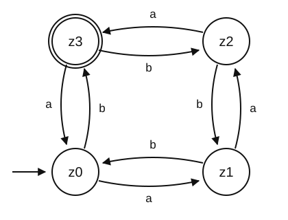

Which strings does it accept? If we try a few, the strings `aaa`, `aaaab` and
`bbaaabaaa` finish in $z_3$, while `aa`, `abba` and `bbb` do not. The pattern
is that reading `a` moves one step forward around the cycle of states and
reading `b` moves one step backward. Therefore, the automaton accepts exactly
the words $y$ with

$$(\text{number of } a\text{'s in } y) - (\text{number of } b\text{'s in } y) \equiv 3 \pmod 4.$$

This example shows what a finite automaton can do. It counts, but only modulo
a fixed number, because four states cannot remember more than that. Let's
trace the input `abb`. The automaton starts in $z_0$. Reading `a` gives
$\delta(z_0,a) = z_1$, reading the first `b` gives $\delta(z_1,b) = z_0$, and
reading the second `b` gives $\delta(z_0,b) = z_3$. Since $z_3$ is an accept
state, the input is recognized, which means that `abb` is part of the
language of the DFA.

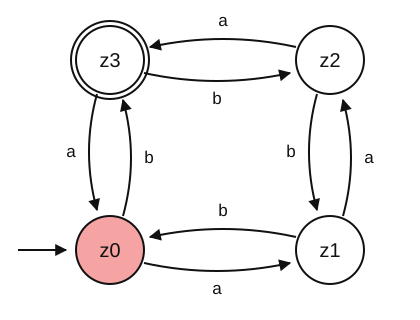


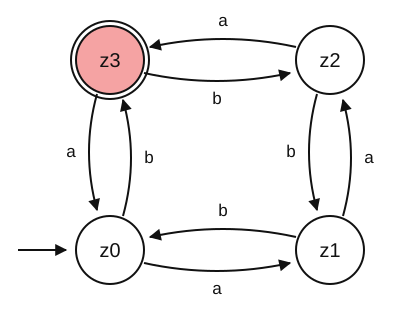

The trace of `aab` goes through $z_0$, $z_1$, $z_2$ and back to $z_1$. Since
$z_1$ is not an accept state, the input is not recognized.


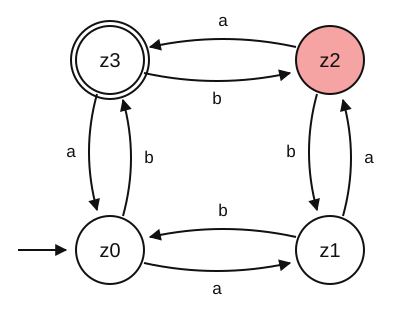

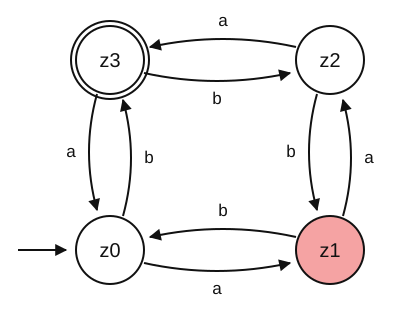

---

## 3. Nondeterministic automata

So far the state changes were deterministic, i.e. every input character
causes at most one state change. A *nondeterministic* automaton can select
among several transitions, and it accepts any word that has at least one path
from the start state $q_0$ to an accept state. Formally, a nondeterministic
finite state automaton (NFA) is the same 5-tuple as a DFA except that the
transition function is $\delta: Q \times \Sigma \rightarrow \mathcal{P}(Q)$.
Here $\mathcal{P}(Q)$ is the power set of $Q$, i.e. the set of all its
subsets, so a transition returns a set of possible next states. An NFA can
also have $\varepsilon$-transitions, which are taken without reading any
input symbol.

The theorem of Rabin and Scott (1959) states that any NFA can be simulated by
a DFA. In other words, NFAs and DFAs are equivalent because they recognize
exactly the same languages. The equivalent DFA might have many more states,
up to $2^{|Q|}$ with one state per subset of $Q$, but it always exists. We
still use NFAs because they are much easier to write and to reason with. With
an NFA you describe what should be accepted without deciding how to keep
track of it, and the conversion to a DFA is mechanical.

---

## 4. Formal languages and grammars {#formal-languages}
The initial motivation of grammars is the following question. How do we
ensure that a command or input is a syntactically correct part of a given
language? This question gave rise to automata theory. Informally, an
automaton is a state-space representation of a program, i.e. a description of
the program flow through incremental transitions between elementary program
states. Grammars help us to answer the complementary question of what can be
computed with a finite-state automaton. A grammar is a formal set of rules
from which you can derive all the inputs that the automaton accepts and no
input that it does not accept.

We first need two pieces of nomenclature. The *Kleene star* $*$ is an
operation on a set $V$ that amounts to the concatenation of $V$ with itself
any finite number of times. It produces any finite combination of the
elements of $V$, including the empty word $\varepsilon$. For example, for
$V = \{+, 1, 2\}$ we have

$$V^* = \{\varepsilon, +, 1, 2, +1, +2, 2+, 12, 1{+}2, {+}12, {+}{+}{+}{+}, \dots\},$$

and $V^+$ is $V^*$ without the empty word. A *formal language* $L$ is a set
of strings of symbols formed from its alphabet $\Sigma$, formally $L
\subseteq \Sigma^*$. This is an abstract definition. In practice, a
well-formed programming language further requires the definition of an
appropriate grammar $G$ that limits which words are syntactically permitted.

A *grammar* is a finite set of formal rules for generating syntactically
correct sentences. Formally, it is a 4-tuple $G = (N, \Sigma, P, S)$ with the
following elements:

- $N$ is a finite set of **variables** or non-terminal symbols. They take
  part in the generation of a sentence but are not components of it, and they
  are denoted by capital letters.
- $\Sigma$ is the alphabet of **terminal symbols**, with $N \cap \Sigma =
  \emptyset$. They are the components of the sentences generated by the
  grammar, and they are denoted by small letters.
- $P$ is the finite set of **production rules**, $P \subseteq (N \cup
  \Sigma)^+ \times (N \cup \Sigma)^*$. Each rule maps one string of symbols
  to another and is written with an arrow.
- $S \in N$ is the **start variable**.

### Example: arithmetic expressions

As an example, consider a grammar that generates properly bracketed
arithmetic expressions. It has $N = \{\textit{Expr}, \textit{Term},
\textit{Fact}\}$, $\Sigma = \{(, ), a, +, *\}$, $S = \textit{Expr}$ and the
following production rules:

1. $\textit{Expr} \rightarrow \textit{Term}$
2. $\textit{Expr} \rightarrow \textit{Expr} + \textit{Term}$
3. $\textit{Term} \rightarrow \textit{Fact}$
4. $\textit{Term} \rightarrow \textit{Term} * \textit{Fact}$
5. $\textit{Fact} \rightarrow a$
6. $\textit{Fact} \rightarrow (\textit{Expr})$

The derivation of $a * (a + a) + a$ applies the rules to the variables of the
current string, as shown in the following table. Some steps apply several
rules at a time to save space.

| rules | current string |
|---|---|
| | $S = \textit{Expr}$ |
| (2) | $\textit{Expr} + \textit{Term}$ |
| (1) | $\textit{Term} + \textit{Term}$ |
| (4)(3) | $\textit{Term} * \textit{Fact} + \textit{Fact}$ |
| (3)(6)(5) | $\textit{Fact} * (\textit{Expr}) + a$ |
| (5)(2) | $a * (\textit{Expr} + \textit{Term}) + a$ |
| (1)(3) | $a * (\textit{Term} + \textit{Fact}) + a$ |
| (3)(5) | $a * (\textit{Fact} + a) + a$ |
| (5) | $a * (a + a) + a$ |

Notice that the structure of the rules encodes operator precedence. An
`Expr` is a sum of `Term`s and a `Term` is a product of `Fact`s, so
multiplication is applied before addition. Real compilers parse expressions
with grammars of this kind.

### Grammar and automaton

A *regular grammar* is a grammar $G = (N, \Sigma, P, S)$ whose rules all have
the form $A \rightarrow aB$ or $A \rightarrow a$. A regular grammar is
equivalent to an automaton $M = (Q, \Sigma, \delta, q_0, \{X\})$ under the
following mapping:

- The automaton uses the same **input alphabet** $\Sigma$.
- The **states** are $Q = N \cup \{X\}$ with $X \notin N$, i.e. the variables
  of the grammar plus one additional state $X$.
- The **initial state** is $q_0 = S$, i.e. the start variable.
- The only **accept state** is the new state $X$. Note that $X$ names a
  single state here, while in the definition of the DFA it named the set of
  accept states.
- The **transitions** come from the production rules. We have $\delta(A,a)
  \ni B$ if $A \rightarrow aB \in P$, i.e. there is a transition from state
  $A$ to state $B$ on input $a$, and $\delta(A,a) \ni X$ if $A \rightarrow a
  \in P$, i.e. there is a transition from state $A$ to the accept state $X$
  on input $a$.

For example, take the grammar with $N = \{S, A, B\}$, $\Sigma = \{a, b\}$ and
$P = \{S \rightarrow aB,\; B \rightarrow bA,\; A \rightarrow b,\; A
\rightarrow bS\}$. The *language defined by* $G$ is $L(G) = \{\, w \in
\Sigma^* \mid S \Rightarrow_G^* w \,\}$, i.e. the set of words that $G$
derives in zero or more steps from $S$. For this grammar $L(G) = \{(abb)^n
\mid n \geq 1\}$, because every derivation produces $abb$ and then either
stops or starts again from $S$.

---

## 5. Regular languages

Every language recognizable by finite automata is a *regular language*.
Regular languages have a second description based on regular expressions.
$R$ is a *regular expression* if $R$ is a single character $a \in \Sigma$,
the empty word $\varepsilon$, the empty set $\emptyset$, an alternative $R_1
\mid R_2$ of two regular expressions, a concatenation $R_1 R_2$ of two
regular expressions, or a repetition $R_1^*$ of a regular expression. This is
the entire definition. Everything else in a regular expression library, such
as `+`, `?`, `{2,5}` and character classes, is shorthand built from these six
rules.

Regular expressions are the practical side of this theory and you will use
them often for text processing. The important consequence of the theorem is
that a finite automaton can recognize anything that a regular expression can
match and vice versa. This also tells you what regular expressions cannot do,
as we will see next with a language that needs a more powerful machine. The
XKCD comic *Regular Expressions* listed in the references is funny because it
is true, since regular expressions feel like a superpower the first time they
save you an afternoon of work. To see how a regular expression in Python can
take exponential time on an input that an automaton would process in linear
time, follow section 1 of the [Python examples notebook of this session](https://github.com/dgarcia-eu/ICSS/blob/main/PythonExamples/Examples09-TheoreticalCS.ipynb).

---

## 6. Turing machines {#turing-machines}
Here is a simple language that a DFA cannot recognize:

$$L = \{a^n b^n \mid n \geq 1\}, \qquad S \rightarrow ab \mid aSb.$$

Its words are `ab`, `aabb`, `aaabbb` and so on. To check whether a word
belongs to this language you must count the $a$'s and compare the count with
the number of $b$'s. However, $n$ is unbounded while the automaton has
finitely many states, so no fixed number of states can remember an arbitrary
count. This limitation is systematic and it is described by the *Chomsky
hierarchy*, which is shown in the following table.

| Type | Class | Automaton | Recognizes |
|---|---|---|---|
| 0 | Recursively enumerable | Turing machine, infinite memory | all |
| 1 | Context sensitive | Linear bounded Turing machine | $a^n b^n c^n$ |
| 2 | Context free | Pushdown automaton (stack) | $a^n b^n$ |
| 3 | Regular | Finite state automaton | $a^n$ |

Each level adds memory. Type 3 has no memory beyond the state, type 2 has a
stack, type 1 has a bounded tape and type 0 has an unbounded tape. With more
memory, the machine can recognize more languages. The machine at the top of
the hierarchy is the *Turing machine* (TM), which has the following parts:

- A **tape** of infinitely many cells. Each cell contains an input symbol or
  a special blank symbol, and the machine can read and write those symbols
  one at a time.
- A **head** that points to the cell currently being read and can move in
  both directions.
- A **state register** that stores the current state of the machine, which is
  taken from a finite set of states.
- A finite **table of instructions** that describes how the machine reads,
  writes and changes state.

Formally, a Turing machine is a 7-tuple $TM = (Q, \Sigma, \Gamma, \delta,
q_0, \square, F)$ with the following elements:

- $Q$ is a finite set of **states**.
- $\Sigma$ is the **input alphabet**, with $Q \cap \Sigma = \emptyset$.
- $\Gamma$ is the **working alphabet** of symbols that can be written on the
  tape, with $\Sigma \subset \Gamma$.
- $\delta: Q \times \Gamma \rightarrow Q \times \Gamma \times \{L, R, N\}$ is
  the **transition function** in the deterministic case. In the
  nondeterministic case it is $\delta: Q \times \Gamma \rightarrow
  \mathcal{P}(Q \times \Gamma \times \{L, R, N\})$.
- $q_0 \in Q$ is the **start state**.
- $\square \in \Gamma$ is the **blank symbol**. Initially, the tape is filled
  with it except for the input.
- $F \subseteq Q$ is the set of **final states**. The input is accepted if
  any state of $F$ is reached.

The transition function $\delta$ goes from the pair (state, symbol read) to
the triple (next state, symbol written, movement of the head), where the
possible movements are left, right and none. For example, the transition
$\delta(z, a) = (z', b, x)$ means that when the TM is in state $z$ and $a$ is
under the head, it transitions to state $z'$, writes $b$ in the cell under
the head, and then moves the head according to $x \in \{L, R, N\}$. In the
initial state only the input is written on the tape, the head is on the first
input symbol, and all unused cells contain $\square$. An alternative notation
for the blank symbol is `#`.

### Worked example: checking parentheses

Let's follow an example taken from Evans (2011, chapter 6). The problem is to
check that the parentheses in the input are balanced. For example,
`()(())(()())` is balanced and `((()()` is not. The input tape contains the
string of parentheses with `#` at the beginning and at the end to mark its
limits. The output is a `1` on the tape if the input is balanced and a `0`
otherwise, where only what is written on the cell under the head matters. The
strategy has three parts:

1. **Match one pair.** Look for a closing parenthesis and replace it with
   `X`. Then find its matching opening parenthesis and replace it with `X`
   too. If a `#` is found instead of a matching opening parenthesis, write
   `0`.
2. **Repeat.** Do this until a `#` is reached while looking for a closing
   parenthesis.
3. **Check the tape.** If the tape is then all `X` between the two `#`, write
   `1`.

The machine has three working states, namely `LookForClosing`, `LookForOpen`
and `CheckTape`. The following figures trace it on a small input.

The TM starts in the leftmost cell of the input in state `LookForClosing` and
moves right without rewriting until the first `)`.

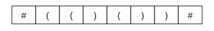

When `)` is under the head, the TM changes to `LookForOpen`, writes `X` and
moves the head left. It keeps moving left while it sees `X`.

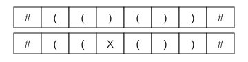

When `(` is under the head, the TM changes to `LookForClosing`, writes `X`
and moves the head right. It keeps moving right while it sees `X` or `)`.

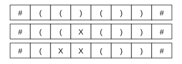

The process continues by matching parentheses and switching between
`LookForClosing` and `LookForOpen`.

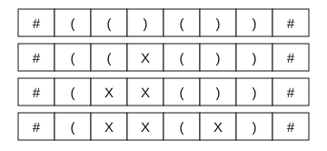

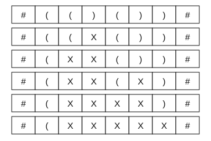

After the last `(` is rewritten, the TM is in `LookForClosing`. It goes right
until it finds `#`, changes to `CheckTape`, and starts moving left while it
sees `X`.

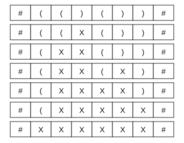

When the TM finds `#` while in `CheckTape`, it overwrites it with a `1`,
which means accept, and halts.

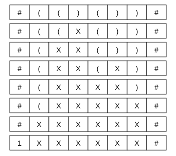

Notice how the machine uses its tape as memory. The `X`s record which
parentheses have already been matched. A finite automaton has no way to store
this information, which is why it cannot solve this problem while a Turing
machine can.

A *nondeterministic Turing machine* has the transition function $\delta: Q
\times \Gamma \rightarrow \mathcal{P}(Q \times \Gamma \times \{L,R,N\})$, so a
combination of state and tape symbol can lead to more than one triple of
state, symbol and action. All paths happen in parallel. An equivalent way to
think about it is that the TM takes the smartest path towards accepting. The
input is accepted if any path leads to an accepting state, and it is rejected
if all paths lead to a rejecting state or are infinite. A nondeterministic TM
is a theoretical device and not a machine that can be built. We will use it
later in this session to define the class NP.

Alan Mathison Turing (1912–1954) designed the TM to formalize algorithms. He
defined computation as the set of problems that can be solved by algorithms
and found examples of problems that cannot be computed. He is famous for his
work during the Second World War to crack the Enigma code with an
electromechanical machine called the Bombe, and he was among the first to
work on artificial intelligence. The Turing test proposes to define AI as
machines able to pass as human a given percentage of the time when chatting
with people. He died in 1954, by suicide according to the inquest, two years
after being prosecuted for his homosexuality and forced to undergo hormone
treatment.

---

## 7. Computability {#computability}
Recall from the Algorithms session that an algorithm is a self-contained,
step-by-step set of operations to solve a given problem, and that algorithms
always terminate, i.e. for correct inputs the algorithm must terminate in a
finite number of steps. A problem is *computable* if there exists an
algorithm that solves it. If we can prove that no algorithm can solve a
problem in finite time, the problem is *noncomputable*.

Up to now our definition of algorithm has been intuitive. We can tell what is
an algorithm and what is not, but we lack a mathematical definition. Alonzo
Church and Alan Turing worked in parallel to formalize it, Church with the
lambda calculus and Turing with his machines, and they reached equivalent
definitions. The result is the *Church-Turing thesis*, which states that an
algorithm is what can be computed by a Turing machine. It is a thesis and not
a theorem, i.e. a statement from which the rest of computer science is
derived but which has no formal proof. It cannot have a proof because it
equates a formal object, the TM, with an informal one, namely our intuition
of an algorithm. Its support is that every model of computation proposed in
the last ninety years has turned out to be equivalent to a TM or weaker.

### A noncomputable problem: the halting problem

The *halting problem* takes as input a string representing a program, for
example in Python, and outputs `True` if evaluating the input program would
ever finish and `False` otherwise. Assume that `halts(X)` is an algorithm
that solves it, where `X` is the Python code given as input. This means that
`halts(X)` returns `True` if evaluating `X` would finish in finite time and
`False` otherwise, for example:

```python
halts('(2 + 3)')            # True
halts('while True: pass')   # False
```

These two cases look reasonable, but consider the following one:

```python
halts('n = 4;
       while sumOfTwoPrimes(n):
           n = n + 2')      # = ?
```

This program halts exactly when it finds an even number that is not the sum
of two primes, i.e. exactly when Goldbach's conjecture is false. Answering it
would settle an open problem in mathematics that is 280 years old, which is a
hint that `halts` cannot exist. The proof is by contradiction. If we assume
that `halts(X)` exists, then the following is a legitimate program:

```python
def paradox():
    if halts('paradox()'):
        while True:
            pass
```

What does `halts('paradox()')` return? If it returns `True`, the program
enters an infinite loop, so it does not halt and `halts('paradox()')` cannot
be `True`. If it returns `False`, the program skips the loop and terminates,
so it does halt and `halts('paradox()')` cannot be `False`. Since it has to
be one or the other, `halts(X)` cannot exist.

Notice that this argument only used the ability to write a program that calls
`halts` on its own source. Your knowledge of Python is a model of computing,
so the proof above is a complete and rigorous proof phrased in Python instead
of Turing machines. Turing showed the same for TMs as a general model of
computing, which means that the result is universal and not a peculiarity of
Python. The halting problem is also not an isolated case. By similar
arguments, any non-trivial question about the behavior of arbitrary programs
is undecidable, which is a result known as Rice's theorem. For this reason,
perfect static analysis, perfect virus detection and perfect automated bug
finding are impossible in principle and not only hard. To see what this means
in practice with a short loop that nobody can prove to stop for every input,
follow section 3 of the [Python examples notebook of this session](https://github.com/dgarcia-eu/ICSS/blob/main/PythonExamples/Examples09-TheoreticalCS.ipynb).

---

## 8. Universal machines and Turing completeness

Turing machines can be encoded with finite codes, for example a state list, a
transition table and an alphabet. A *universal Turing machine* simulates a TM
whose code is written on its tape, followed by the input of that TM. The
universal TM then writes the output of the simulated TM and stops if the
simulated TM stops. This is the theoretical version of an idea from the
Introduction session, namely a machine that runs a changeable program. It
means that hardware and software are the same kind of thing and that a
program is data. A model of computation such as a machine model or a
programming language is *Turing complete* if it can be used to simulate a
universal Turing machine. Turing complete models can execute any algorithm.
For example, Python is Turing complete because you can write Python code that
simulates any Turing machine and thus, by definition, can execute any
algorithm. In practice you code algorithms directly in Python without
simulating a TM. The point is that you can simulate a TM, but not that doing
so is easy, understandable or efficient.

There are two families of examples of Turing complete models. *Cellular
automata* are models of computation in which cells change state according to
extremely simple rules. Structures emerge that can be set up to simulate any
TM when they interact, and the standard examples are Conway's Game of Life
and rule 110. Games can be used in the same way. Minecraft and Magic: The
Gathering (Churchill, Biderman & Herrick, 2019) can simulate a universal
Turing machine. Sokoban puzzles can simulate any Turing machine with a
bounded tape, which is what Culberson (1997) showed by proving that Sokoban
is PSPACE-complete. These examples are not meant to be useful. Rather, they
show that Turing completeness is easy to achieve accidentally because a
handful of rules is often enough. Once a system is Turing complete, the
halting problem applies to it. For example, you cannot predict in general
what a Magic deck will do.

---

## 9. Complexity classes {#complexity-classes}
In terms of a TM, *time complexity* is the number of transitions that the TM
has to make to reach a final state. For a nondeterministic TM it is the
maximum depth among all execution branches. Recall the ordering of O-classes
from the Time Complexity session:

$$O(1) \subset O(\log n) \subset O(n) \subset O(n\log n) \subset O(n^2) \subset O(2^n) \subset O(n!).$$

We can talk about the complexity of a *problem* in terms of the time
complexity of the known algorithms to solve it. This defines a hierarchy.
Inefficient algorithms with long running times can be written for almost any
problem, but some problems might not be solvable with faster ones. We define
sets of problems called *complexity classes* that relate problems to the time
complexity of the algorithms that can solve them. The theory is stated for
*decision problems*, which have a binary output, i.e. true or false. Decision
problems can be very general. For example, determining whether a word belongs
to a language is a decision problem. Most questions can be rephrased as a
decision problem, for example *"is there a route shorter than $k$?"* instead
of *"what is the shortest route?"*.

### The class P

The class P contains all decision problems that can be solved by a
deterministic Turing machine using a polynomial amount of computation steps.
In other words, for each problem in P there is at least one algorithm that
decides its output in a number of steps that grows polynomially with the
input size, such as $O(n)$, $O(n^2)$ or $O(n^{99})$. This also includes
subpolynomial growth, since $O(\log n) \subset O(n)$. An example of a problem
in P is deciding whether there is a path between two vertices of a graph. You
can run DFS on the graph to find the path, and since DFS runs in
$O(|V|+|E|)$, the problem belongs to P. P is the usual formalization of
*"efficiently solvable"*. It is imperfect, because an $O(n^{99})$ algorithm
is polynomial but useless in practice. However, it is robust, because it does
not change if you switch machine models, and a theoretical definition needs
this property.

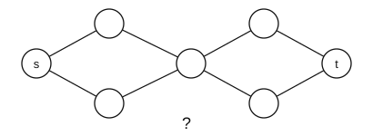

### Verifiers and the class NP

After solving a problem, you can *verify* whether the solution is correct. A
*verifier* is an algorithm, i.e. a TM, that takes two inputs, namely a
description or encoding of a problem $p$ and a candidate solution $c$. It
returns `True` if $c$ is a solution of $p$ and `False` otherwise. The
candidate $c$ is also called a *certificate* or *proof* that $p$ has a
solution. Verifying a solution is always a decision problem. For example, for
the problem of finding a path between $s$ and $t$ in $G$, the input tape of
the verifier contains the problem followed by the certificate. The problem is
encoded as the vertex list, the edge list and the indices $s$ and $t$, and
the certificate is a sequence of nodes.

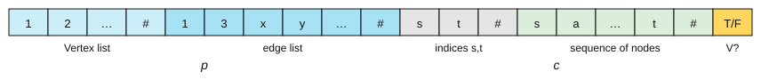

The class NP is the set of decision problems for which positive instances,
i.e. those whose answer is `True`, have proofs verifiable in polynomial time
by a deterministic Turing machine. An equivalent definition is the set of
decision problems solvable in polynomial time by a nondeterministic Turing
machine, which *"guesses"* the proof by branching and then verifies it
deterministically. NP stands for nondeterministic polynomial time. It does
not stand for *"not polynomial"*.

An example of a problem in NP is the Hamiltonian path problem. A *Hamiltonian
path* is a path in a graph that visits each vertex exactly once, where the
edges in the path sequence have to be distinct. The decision problem is
whether $G$ has a Hamiltonian path, which is also phrased as whether $G$ is
traceable. Verifying that a given path is Hamiltonian can be done in
$O(|V|+|E|)$ by walking along the path and marking the vertices, so the
problem is in NP. However, finding a Hamiltonian path is not easy. No known
algorithm finds one in polynomial time, and the known algorithms are
essentially brute force, for example trying all combinations in $O(|V|!)$.
This asymmetry between easy verification and hard search is the subject of
the P versus NP question. To measure this asymmetry on a small grouping
problem, where checking a solution takes microseconds while finding one takes
time that grows exponentially, follow section 2 of the [Python examples notebook of this session](https://github.com/dgarcia-eu/ICSS/blob/main/PythonExamples/Examples09-TheoreticalCS.ipynb).

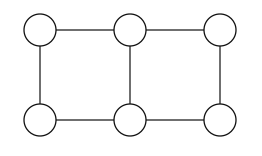

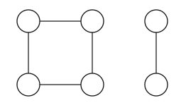

### P versus NP

All problems in P are also in NP, because if you can decide a problem in
polynomial time you can also verify it in polynomial time. As far as anyone
knows, verifying in polynomial time does not imply deciding in polynomial
time. However, this is based on the algorithms currently known, so an NP
problem becomes a P problem when someone invents a polynomial-time algorithm
for it. Proving that P = NP or that P ≠ NP is arguably the most important
open question in computer science. It is one of the Clay Millennium Problems,
with a prize of one million dollars for whoever solves it.

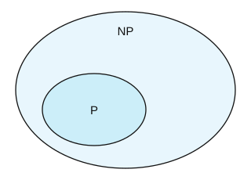

### Reducing problems

*Reducing* a decision problem A to another decision problem B means finding a
function $f$ that maps all inputs of A with output `True` to inputs of B with
output `True`, and all inputs of A with output `False` to inputs of B with
output `False`. An algorithm that solves B can then be used to solve A. If
$f$ can be applied in polynomial time, we say that A is *polynomial-time
reducible* to B. In that case, if B is in P, then A is in P too. Reduction is
the way in which complexity theory transfers knowledge between problems. It
works as in mathematics, where you can solve a new problem because you
already solved another one.

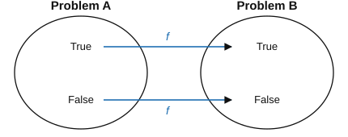

### NP-complete and NP-hard problems

Some NP problems can be reduced in polynomial time to other NP problems. This
determines a network between problems, because if we find a polynomial-time
algorithm that solves one problem, we also solve every problem that can be
reduced to it. Some special NP problems have the property that any other NP
problem can be reduced to them. A problem is *NP-complete* if it belongs to
NP and every other NP problem is polynomial-time reducible to it.

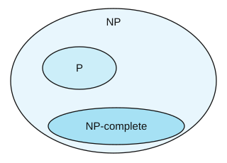

The original NP-complete problem is boolean satisfiability (SAT). Boolean
formulas in propositional logic use three operations, namely AND ($\wedge$),
OR ($\vee$) and negation ($\bar{x}$), over variables that can take the value
True (1) or False (0). SAT takes a boolean formula as input and returns
`True` if and only if there is some assignment of the variables for which the
formula is true. For example, the formula

$$(x_1 \vee x_2 \vee x_3 \vee \bar{x}_4) \wedge (\bar{x}_3 \vee x_5 \vee \bar{x}_6) \wedge (x_3 \vee \bar{x}_6)$$

is satisfiable with $x_1 = x_2 = x_4 = x_5 = $ True and $x_3 = x_6 = $ False,
while the formula

$$(x_1 \vee x_2) \wedge (\bar{x}_1 \vee x_2) \wedge (x_1 \vee \bar{x}_2) \wedge (\bar{x}_1 \vee \bar{x}_2)$$

is not satisfiable, because the four clauses rule out the four possible
assignments. Any NP problem can be reduced to SAT. The Cook-Levin theorem
proves this by showing that finding a halting execution of any
nondeterministic TM can be reformulated as satisfying a logical formula.
Therefore, if you find a polynomial-time algorithm for SAT, then P = NP and
you earn the million dollars.

Finally, a problem is *NP-hard* if every NP problem is polynomial-time
reducible to it. NP-hard problems do not have to be in NP, and they do not
even have to be decision problems. Informally, they are at least as hard as
the hardest problems in NP. The term is often used to convey the lack of
polynomial-time algorithms for problems that are not decision problems, for
example finding a Hamiltonian path in a graph instead of only detecting
whether one exists. The distinction matters in practice. When a paper says
that your problem is NP-hard, you should stop looking for an exact efficient
algorithm and start looking for approximations, heuristics or a restricted
version of the problem that is tractable.

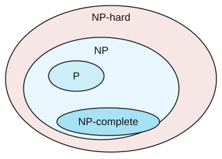

---

## 10. Summary

- **Turing machines** are the most general model of a computer we have seen,
  and they recognize grammars without restrictions.
- **Computability** is defined by the Church-Turing thesis, which says that
  algorithms are what Turing machines compute. Some problems cannot be
  computed, for example the halting problem. A model of computation that can
  simulate a TM is Turing complete.
- **Complexity classes** group problems by the time complexity of the
  algorithms that solve them. P is the class of decision problems solvable in
  polynomial time and NP is the class of problems with proofs verifiable in
  polynomial time. Polynomial-time reducibility relates problems to each
  other. NP-complete problems are the ones to which every NP problem reduces,
  which connects them to the P versus NP question, and NP-hard problems are
  general problems without known efficient algorithms.

---

## 11. Why does this matter? Practical Python examples

Check the [practical Python examples in this Jupyter notebook](https://github.com/dgarcia-eu/ICSS/blob/main/PythonExamples/Examples09-TheoreticalCS.ipynb).
There, you will see a regular expression whose running time in Python doubles
with every extra character of the input, a grouping problem whose solutions
are checked in microseconds but found only by trying subsets, and a short
loop for which nobody can prove that it always stops.

---

## 12. Check yourself

**1.** Why can no DFA recognize "strings with an equal number of a's and b's"?

<details><summary>Answer</summary>

No DFA can recognize this language because it would need to remember the
running difference between the two counts, and that difference is unbounded
while $Q$ is finite. Formally, this is proved with the pumping lemma. In
contrast, the example automaton of this session only tracks the difference
modulo 4, which is a finite amount of information, so four states are enough.

</details>

**2.** NFAs are no more powerful than DFAs. So why use them?

<details><summary>Answer</summary>

We use them because they are more convenient. For example, an NFA for
*"contains the substring ICSS"* is easy to write by guessing where the
substring starts, while the equivalent DFA has to track partial matches
explicitly. Since the conversion is mechanical, you can design with the
easier model and let a tool produce the efficient one. Regular expression
engines that are built as automata work this way internally.

</details>

**3.** Someone claims to have written a program that detects infinite loops in any Python program. What do you say?

<details><summary>Answer</summary>

You should say that the program cannot be correct in general, because
detecting infinite loops in any program is the halting problem. It may be a
useful heuristic that catches common cases, and such tools exist. However, it
must either fail to answer for some inputs or answer wrongly for some, so you
can ask which of the two it does.

</details>

**4.** Your research problem turns out to be NP-hard. Is your project dead?

<details><summary>Answer</summary>

No, but the goal has to change. You can solve small instances exactly, use an
approximation algorithm with a proven bound, use a heuristic and validate it
empirically, restrict the problem, or reformulate it as a problem that you
can solve. Restricting the problem often helps because many NP-hard graph
problems are easy on trees or planar graphs. You should stop looking for an
exact, efficient and general algorithm.

</details>

**5.** If someone proved P = NP tomorrow, what would change?

<details><summary>Answer</summary>

In principle, a great deal would change. Efficient algorithms would exist for
thousands of problems currently considered intractable, such as scheduling,
protein folding and many kinds of optimization. Most public-key cryptography
would also be broken, because its security depends on certain problems being
hard. In practice it would depend on the proof. For example, a
non-constructive proof or one that gives an $O(n^{100})$ algorithm would
change the theory but not the practice. Most researchers expect that P ≠ NP.

</details>

---

## 13. References

- **Sipser, M. (2012).** *Introduction to the Theory of Computation*, 3rd ed.
  Cengage. Chapter 1 (regular languages) is the reading for this session.
  Chapters 3 and 4 cover Turing machines and decidability, and chapter 7 the
  complexity classes.
- **Evans, D. (2011).** *Introduction to Computing: Explorations in Language,
  Logic, and Machines*. <https://computingbook.org/>. Chapter 6 for Turing
  machines and chapter 12 for computability. The parenthesis-checking Turing
  machine of this session is his.
- **Cormen, T. H. (2013).** *Algorithms Unlocked*, chapter 10 ("Hard?
  Problems").
- **Turing, A. M. (1936).** "On Computable Numbers, with an Application to
  the Entscheidungsproblem". *Proceedings of the London Mathematical Society*,
  series 2, 42, 230–265. The machine, and the halting problem.
- **Rabin, M. O. & Scott, D. (1959).** "Finite Automata and Their Decision
  Problems". *IBM Journal of Research and Development* 3(2), 114–125. The
  NFA/DFA equivalence theorem.
- **Chomsky, N. (1956).** "Three models for the description of language".
  *IRE Transactions on Information Theory* 2(3), 113–124. The hierarchy.
- **Cook, S. A. (1971).** "The complexity of theorem-proving procedures".
  *Proceedings of the Third Annual ACM Symposium on Theory of Computing*,
  151–158. The Cook-Levin theorem and NP-completeness.
- **Clay Mathematics Institute.** *P vs NP Problem*.
  <https://www.claymath.org/millennium-problems/p-vs-np-problem>
- **Churchill, A., Biderman, S. & Herrick, A. (2019).** "Magic: The Gathering
  is Turing Complete". *arXiv:1904.09828*.
- **Culberson, J. (1997).** "Sokoban is PSPACE-complete". Technical report
  TR 97-02, University of Alberta.
- **Bairagi, S.** *Emulating Pac-Man using Finite State Machines*. Bachelor
  thesis, IIIT Ranchi. The Pac-Man DFA in the slides.
- **XKCD 208**, *Regular Expressions*: <https://xkcd.com/208/>
