# Session 9: Theoretical Computer Science

*Introduction to Computing for the Social Sciences · lecture transcript*

> Companion text for lecture 9. Notation follows
> [the course conventions](00-Conventions.md).
>
> **Reading for this session:** Chapter 1 of Sipser, *Introduction to the Theory
> of Computation* (2012); chapters 6 and 12 of Evans, *Introduction to Computing*
> (2011); chapter 10 of Cormen, *Algorithms Unlocked* (2013). References at the
> end.

---

## Contents

<!-- MOTIVATION-TOC:BEGIN -->
0. [Motivating examples](#motivating-examples)
<!-- MOTIVATION-TOC:END -->
1. [The questions of theoretical computer science](#1-the-questions-of-theoretical-computer-science)
2. [Finite-state automata](#2-finite-state-automata)
3. [Nondeterministic automata](#3-nondeterministic-automata)
4. [Formal languages and grammars](#4-formal-languages-and-grammars)
5. [Regular languages](#5-regular-languages)
6. [Turing machines](#6-turing-machines)
7. [Computability](#7-computability)
8. [Universal machines and Turing completeness](#8-universal-machines-and-turing-completeness)
9. [Complexity classes](#9-complexity-classes)
10. [Summary](#10-summary)
11. [Check yourself](#11-check-yourself)
12. [References](#12-references)

---

<!-- MOTIVATION-SECTION:BEGIN -->
## Motivating examples

Three candidate openings for this session, each a real situation the
material is the answer to. **One of these will be used in the lecture**;
the others are kept here because they are worth reading anyway.

<!-- MOTIVATION:M09-A:BEGIN -->
### A · The regular expression that took down a large part of the web

On 2 July 2019, Cloudflare, which sits in front of a large fraction of the
world's websites, pushed a routine update to its firewall rules. One of them
was a regular expression intended to detect malicious JavaScript. Within
seconds, CPU usage across the entire global network hit 100% and a
substantial share of the web returned errors. The outage lasted 27 minutes.
The offending pattern contained, in simplified form, the fragment
`.*(?:.*=.*)`, a repetition nested inside a repetition. On certain inputs, a
backtracking matcher has to try an exponential number of ways to split the
input between the two repetitions before concluding that there is no match.
This failure mode is common enough to have a name and a vulnerability
category, catastrophic backtracking, or ReDoS.

What makes this the right story to open this session with is that the
explanation is theoretical, not an engineering slip. A regular expression, in
the mathematical sense, describes exactly what a finite-state automaton can
recognize, a machine with finitely many states that reads the input once,
from left to right, with no memory beyond its current state. Such a machine
has a guaranteed cost, linear in the length of the input, always, and it
cannot backtrack because it has nowhere to backtrack to. The regular
expression engines of most programming languages are not that machine. They
implement extra features, such as backreferences and lookahead, that push the
language beyond regular, and they are built on backtracking search rather
than on an automaton. That is where the exponential comes from. Engines built
as true automata, such as Go's `regexp`, Rust's `regex` and RE2, cannot
exhibit this behavior at all, and pay for it by refusing the extra features.
So the practical question, why one line took down a large part of the web,
has an answer that is entirely about what class of machine is doing the
work, and that is what this session is about.

Section 2 of this session is about finite-state automata, the 5-tuple, the
deterministic and nondeterministic versions, and the guarantee that comes
with them. Section 5 is about regular expressions and their equivalence to
those automata. Section 6 is about what automata cannot do, such as matching
balanced brackets or $a^n b^n$, because they have no unbounded memory, and
about the Chomsky hierarchy, regular, context-free, context-sensitive and
recursively enumerable, with a machine for each level and a strictly higher
price for each. The transferable idea is that the class of machine
determines the guarantee. Once you know that a problem needs only a
finite-state machine, you know it is linear; once you leave that class, you
have given the guarantee up, and it is worth knowing on which side of the
line you are before deploying to a third of the internet.
<!-- MOTIVATION:M09-A:END -->
<!-- MOTIVATION:M09-B:BEGIN -->
### B · 300 students, 40 seminars, and no schedule

The department assigns 300 students to 40 seminars. Students rank their
preferences, seminars have caps, some students have timetable clashes, and a
few combinations are forbidden. Someone does this by hand every semester and
it takes a week. Ask a programmer to automate it and you will get one of two
answers: a program that produces an assignment quickly, or an admission that
producing the best assignment is out of reach, and the gap between those is
the subject of this session. The reason is not lack of cleverness. Assigning
300 students to 40 seminars allows $40^{300}$ configurations, a number with
481 digits, against roughly 80 digits for the count of atoms in the
observable universe. The constraints prune that enormously, but not enough:
problems of this family, constrained assignment, timetabling and scheduling,
are NP-complete, and no polynomial-time algorithm for any of them is known.

Here is why that is a theoretical statement rather than an engineering
complaint, and why it is genuinely useful to know. Checking is easy and
finding is hard: hand me a proposed assignment and I can verify in seconds
that every cap is respected and that no student has a clash, and that
asymmetry, cheap to verify and expensive to find, is the definition of the
class NP. The hard problems are all the same problem: a polynomial-time
algorithm for any NP-complete problem would give one for all of them, because
each can be transformed into the others in polynomial time, so timetabling,
satisfiability, graph coloring and the traveling salesman problem are, in
this precise sense, the same question in different clothes. So "we were not
clever enough" is a claim about thousands of problems and fifty years of
collective effort, not about you and this timetable, and that is what makes
it worth knowing, because it tells you when to stop looking for an exact
efficient algorithm and start looking for a good-enough one. Once you know
that a problem is NP-complete, the options are clear and legitimate: accept
an approximation with a stated quality bound, use a heuristic that is usually
good, restrict the problem to a special case that is tractable, or solve
smaller instances exactly. What you do not do is keep searching for the fast
exact algorithm.

Section 9 of this session covers the classes P and NP, what "verifiable in
polynomial time" means precisely and why it is not the same as "solvable",
the technique of reduction, by which a new problem is shown to be at least as
hard as a known one, which is how hardness is proved rather than assumed,
NP-completeness, and the P versus NP question itself. The exam has repeatedly
asked what NP-completeness means and how it relates to P versus NP. The
answer to have ready is the two-condition definition plus the collapse
statement: solve one in polynomial time and you have solved them all.
<!-- MOTIVATION:M09-B:END -->
<!-- MOTIVATION:M09-C:BEGIN -->
### C · Can a program check your program?

A perfectly reasonable request: before running 300 student submissions on
the marking server, reject the ones that will never stop, because nobody
wants an infinite loop holding a machine for a weekend. It sounds like an
engineering problem, to write an analyzer, look for unbounded loops, and be
conservative. It is not. In 1936 Alan Turing proved that no program can
decide, for an arbitrary program and input, whether it halts. This is the
halting problem, and it is not a statement about our current tools: it holds
for every language, every computer, and every future one. The proof is short
enough to sketch, and it is the most elegant argument in this course. Suppose
a program HALTS($P$, $x$) exists that returns TRUE if program $P$ halts on
input $x$ and FALSE otherwise, and build:

```
Procedure TROUBLE(P)
Inputs:
      P: the source code of a program
Result: halts exactly when HALTS says that P does not halt on itself
If HALTS(P, P)
      then loop forever
      else halt
```

Now ask what TROUBLE(TROUBLE) does. If it halts, then HALTS(TROUBLE,
TROUBLE) returned TRUE, so the first branch ran and it loops forever, a
contradiction. If it loops forever, then HALTS returned FALSE, so the second
branch ran and it halted, again a contradiction. Both branches are
impossible, so the assumption was wrong and HALTS cannot exist. The whole
argument uses nothing about hardware, speed or language, only
self-reference, and that is why it is permanent.

The consequences reach further than the marking server, and they are worth
knowing because they set the boundary of what any tool can promise. By
reduction to the halting problem, none of the following is decidable in
general either: whether a program ever prints a particular string, whether
two programs compute the same function, whether a program ever accesses
memory it should not, or whether a piece of code is unreachable. This is why
compilers give conservative warnings rather than guarantees, why static
analyzers report false positives, and why no antivirus can be complete; each
is doing the best possible job on a problem that has no complete solution.
Note the contrast with the bounded version. Whether a program halts within 1
000 steps is decidable, since you just run it for 1 000 steps, so adding a
bound turns an undecidable question into a decidable one. That is what real
marking systems do: a timeout, not an analysis.

Section 6 of this session presents Turing machines, the model that makes
"any program at all" a mathematically precise notion, and section 7 the
Church-Turing thesis that says it captures everything computable, together
with the halting problem, with the argument above set out properly. Section
9 covers reduction, the technique that converts one impossibility result
into a hundred, and the complexity classes. The distinction to carry away,
and to keep separate from session 8, is that hard means that we do not know a
fast algorithm, while undecidable means that no algorithm exists. The second
is a much stronger claim, and one of the few things in computing that will
never change.
<!-- MOTIVATION:M09-C:END -->
---

<!-- MOTIVATION-SECTION:END -->
## 1. The questions of theoretical computer science

Theoretical computer science asks what we can compute, what the principles of
computing machines are, and how a computing machine has to be structured to
perform any computing task. Its topics are the formal definition of
languages and their classification, ways of formalizing computation as an
abstract process of transitions between the states of a program,
independently of its implementation, and proofs of computability based on
these constructs. To model computing we have to abstract three things. The
input breaks down to accepting a finite sequence of bits. The output is also
a finite sequence of bits, from which we can in principle constitute anything,
such as numbers, graphics or sound. The processing consists in principle of
bit-by-bit operations, but we need memory to keep track of intermediate
steps, and the power of a computing model ultimately changes with its ability
to memorize those steps; we also need rules that define how we transition
from one operation to the next, so that, more generally, a computing machine
must have rules to transition between a finite number of internal states.
That last sentence is the whole design. The rest of this lecture presents
three machines, each with more memory than the last, and the discovery that
the third one is as powerful as anything can be.

The lecture warms up with the ghosts of Pac-Man. The ghosts have actions that
depend on their state, which can be wandering around the maze, chasing
Pac-Man, fleeing from Pac-Man, or going to base to resurrect, and their
actions depend on the input produced by the player and the game: Pac-Man gets
close to a ghost, goes far from it, eats a special pellet, touches a ghost and
loses, eats a ghost while a pellet is active, the pellet expires, or Pac-Man
eats all the pellets. The ghosts are automata: they have states, and
transitions between states that depend on the input.

---

## 2. Finite-state automata

A *deterministic finite state automaton* (DFA) is defined by a 5-tuple $M =
(Q, \Sigma, \delta, q_0, X)$ consisting of a finite set of states $Q$, a
finite set of input symbols $\Sigma$ called the alphabet, with $Q \cap \Sigma
= \emptyset$, a transition function $\delta: Q \times \Sigma \rightarrow Q$,
an initial or start state $q_0 \in Q$, and a set of accept states $X
\subseteq Q$. The automaton is initially in the start state $q_0$; the input
word is read character by character, and the automaton transitions from state
to state according to each character. If it ends in an accept state, the word
is part of the language, and if not, it is not. By convention, if a
transition is not defined for a state and a character, the automaton goes to
a non-accepting reject state. Note what the machine does not have: memory
beyond the current state. It cannot count arbitrarily high, because counting
to $n$ needs $n$ states and $Q$ is finite, and that limitation is what
motivates the machines of the later sections.

The worked automaton of the lecture has $Q = \{z_0, z_1, z_2, z_3\}$, $\Sigma
= \{a, b\}$, $q_0 = z_0$, $X = \{z_3\}$, and the transition function
$\delta(z_0,a)=z_1$, $\delta(z_0,b)=z_3$, $\delta(z_1,a)=z_2$,
$\delta(z_1,b)=z_0$, $\delta(z_2,a)=z_3$, $\delta(z_2,b)=z_1$,
$\delta(z_3,a)=z_0$, $\delta(z_3,b)=z_2$.

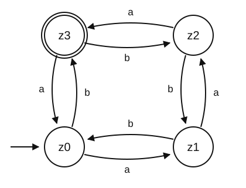

Which strings does it accept? Trying a few, `aaa`, `aaaab` and `bbaaabaaa`
finish in $z_3$, while `aa`, `abba` and `bbb` do not. The pattern is that
reading `a` moves one step forward around the cycle and reading `b` moves one
step backward, so the automaton accepts exactly the words $y$ with

$$(\text{number of } a\text{'s in } y) - (\text{number of } b\text{'s in } y) \equiv 3 \pmod 4.$$

This is a good illustration of what a finite automaton can do: it counts, but
only modulo a fixed number, because that is all four states can remember. The
trace of `abb` starts in $z_0$; reading `a` gives $\delta(z_0,a) = z_1$,
reading `b` gives $\delta(z_1,b) = z_0$, and reading `b` gives $\delta(z_0,b)
= z_3$. Since $z_3$ is an accept state, the input is recognized: `abb` is
part of the language of the DFA.

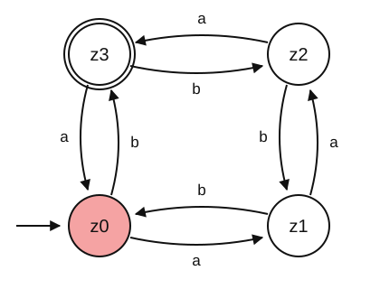
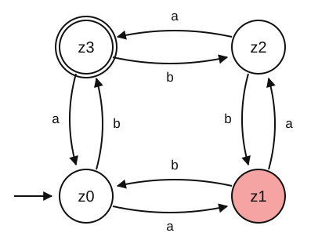

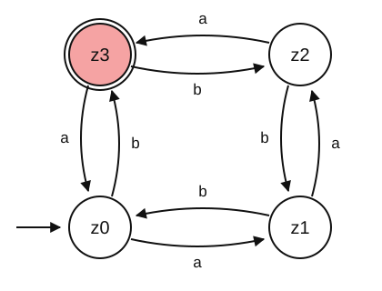

The trace of `aab` goes $z_0$, $z_1$, $z_2$, $z_1$, and since $z_1$ is not an
accept state the input is not recognized.


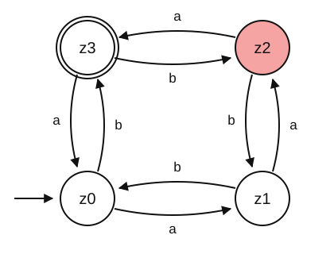


---

## 3. Nondeterministic automata

So far the state changes were deterministic: every input character causes at
most one state change. A *nondeterministic* automaton can select among
several transitions, and it accepts any word that has at least one path from
the start state $q_0$ to an accept state. Formally, a nondeterministic finite
state automaton (NFA) is the same 5-tuple except that the transition function
is $\delta: Q \times \Sigma \rightarrow \mathcal{P}(Q)$, where $\mathcal{P}(Q)$
is the power set of $Q$, the set of all its subsets, so that a transition
returns a set of possible next states. An NFA can also have
$\varepsilon$-transitions, which are taken without reading any input symbol.
The theorem of Rabin and Scott (1959) states that any NFA can be simulated by
a DFA, so NFAs and DFAs are equivalent: they recognize exactly the same
languages. The DFA might have many more states, up to $2^{|Q|}$, one per
subset, but it exists. Why bother with NFAs, then? Because they are much
easier to write and to reason with. You describe what should be accepted
without deciding how to track it, and the conversion is mechanical. This is a
recurring pattern in theory: a convenient model, plus a theorem that it adds no
power.

---

## 4. Formal languages and grammars

The initial motivation of grammars is the question of how we ensure that a
command or input is a syntactically correct part of a given language. This
question gave rise to automata theory; informally, an automaton is a
state-space representation of a program, that is, a description of the
program flow through incremental transitions between elementary program
states. Grammars answer the complementary question of what can be computed
with a finite-state automaton: a grammar is a formal set of rules from which
you can derive all the inputs that the automaton accepts and no input that it
does not accept.

Two pieces of nomenclature come first. The *Kleene star* $*$ is an operation
on a set $V$ that amounts to the concatenation of $V$ with itself any finite
number of times, that is, any finite combination of the elements of $V$,
including the empty word $\varepsilon$; for $V = \{+, 1, 2\}$,

$$V^* = \{\varepsilon, +, 1, 2, +1, +2, 2+, 12, 1{+}2, {+}12, {+}{+}{+}{+}, \dots\},$$

and $V^+$ is $V^*$ without the empty word. A *formal language* $L$ is a set
of strings of symbols formed from its alphabet $\Sigma$, formally $L
\subseteq \Sigma^*$. This is an abstract definition: in practice, a
well-formed programming language further requires the definition of an
appropriate grammar $G$ that limits which words are syntactically permitted.

A *grammar* is a finite set of formal rules for generating syntactically
correct sentences. Formally, it is a 4-tuple $G = (N, \Sigma, P, S)$ where
$N$ is a finite set of variables or non-terminal symbols, denoted by capital
letters, which take part in the generation of a sentence but are not
components of it; $\Sigma$ is the alphabet of terminal symbols, denoted by
small letters, with $N \cap \Sigma = \emptyset$, which are the components of
the sentences generated by the grammar; $P$ is the finite set of production
rules, $P \subseteq (N \cup \Sigma)^+ \times (N \cup \Sigma)^*$, which map one
string of symbols to another and are written with an arrow; and $S \in N$ is
the start variable.

### Example: arithmetic expressions

The example of the lecture is a grammar that generates properly bracketed
arithmetic expressions, with $N = \{\textit{Expr}, \textit{Term},
\textit{Fact}\}$, $\Sigma = \{(, ), a, +, *\}$, $S = \textit{Expr}$ and the
production rules

1. $\textit{Expr} \rightarrow \textit{Term}$
2. $\textit{Expr} \rightarrow \textit{Expr} + \textit{Term}$
3. $\textit{Term} \rightarrow \textit{Fact}$
4. $\textit{Term} \rightarrow \textit{Term} * \textit{Fact}$
5. $\textit{Fact} \rightarrow a$
6. $\textit{Fact} \rightarrow (\textit{Expr})$

The derivation of $a * (a + a) + a$ applies the rules to the variables of the
current string, several at a time when it saves space:

| rules | current string |
|---|---|
| | $S = \textit{Expr}$ |
| (2) | $\textit{Expr} + \textit{Term}$ |
| (1) | $\textit{Term} + \textit{Term}$ |
| (4)(3) | $\textit{Term} * \textit{Fact} + \textit{Fact}$ |
| (3)(6)(5) | $\textit{Fact} * (\textit{Expr}) + a$ |
| (5)(2) | $a * (\textit{Expr} + \textit{Term}) + a$ |
| (1)(3) | $a * (\textit{Term} + \textit{Fact}) + a$ |
| (3)(5) | $a * (\textit{Fact} + a) + a$ |
| (5) | $a * (a + a) + a$ |

Notice that the structure of the rules encodes operator precedence: an
`Expr` is a sum of `Term`s and a `Term` is a product of `Fact`s, so
multiplication binds tighter than addition. This is exactly how real
compilers parse expressions.

### Grammar and automaton

A grammar $G = (N, \Sigma, P, S)$ whose rules all have the form $A
\rightarrow aB$ or $A \rightarrow a$, which is called a *regular grammar*, is
equivalent to an automaton $M = (Q, \Sigma, \delta, q_0, \{X\})$ under the
following mapping. The automaton uses the same input alphabet $\Sigma$. Its
states are $Q = N \cup \{X\}$ with $X \notin N$, that is, the variables of the
grammar plus one extra state $X$, which is the only accept state (note that
$X$ names a single state here, while in the definition of the DFA it named
the set of accept states). The initial state is $q_0 = S$, the start
variable. And $\delta(A,a) \ni B$ if $A \rightarrow aB \in P$, a transition
from $A$ to $B$ on input $a$, while $\delta(A,a) \ni X$ if $A \rightarrow a
\in P$, a transition to the accept state on input $a$. The example of the
lecture has $N = \{S, A, B\}$, $\Sigma = \{a, b\}$ and $P = \{S \rightarrow
aB,\; B \rightarrow bA,\; A \rightarrow b,\; A \rightarrow bS\}$. The
*language defined by* $G$ is $L(G) = \{\, w \in \Sigma^* \mid S \Rightarrow_G^*
w \,\}$, the set of words that $G$ derives in zero or more steps from $S$,
and for this grammar $L(G) = \{(abb)^n \mid n \geq 1\}$, since every
derivation produces $abb$ and then either stops or starts again from $S$.

---

## 5. Regular languages

Every language recognizable by finite automata is a *regular language*, and
regular languages have a second description. $R$ is a *regular expression*
if $R$ is a single character $a \in \Sigma$, the empty word $\varepsilon$, the
empty set $\emptyset$, an alternative $R_1 \mid R_2$ of two regular
expressions, a concatenation $R_1 R_2$ of two regular expressions, or a
repetition $R_1^*$ of a regular expression. That is the entire definition;
everything else in a regular expression library, such as `+`, `?`, `{2,5}`
and character classes, is shorthand built from these six rules. Regular
expressions are the practical face of this theory, and you will use them
constantly for text processing. The important consequence of the theorem is
that anything a regular expression can match, a finite automaton can
recognize, and vice versa, which also tells you what regular expressions
cannot do, as the next section shows. The XKCD comic shown in the lecture is
funny because it is true: regular expressions feel like a superpower the
first time they save you an afternoon.

---

## 6. Turing machines

Here is a simple language that a DFA cannot recognize:

$$L = \{a^n b^n \mid n \geq 1\}, \qquad S \rightarrow ab \mid aSb.$$

Its words are `ab`, `aabb`, `aaabbb` and so on. To check whether a word
belongs to it you must count the $a$'s and compare with the $b$'s, and $n$
is unbounded while the automaton has finitely many states, so no fixed
number of states can remember an arbitrary count. This gap is systematic,
and it is organized by the *Chomsky hierarchy*:

| Type | Class | Automaton | Recognizes |
|---|---|---|---|
| 0 | Recursively enumerable | Turing machine, infinite memory | all |
| 1 | Context sensitive | Linear bounded Turing machine | $a^n b^n c^n$ |
| 2 | Context free | Pushdown automaton (stack) | $a^n b^n$ |
| 3 | Regular | Finite state automaton | $a^n$ |

Each level adds memory: none for type 3, a stack for type 2, a bounded tape
for type 1 and an unbounded tape for type 0, and with more memory come more
languages. The machine at the top is the *Turing machine* (TM). It has a tape
of infinitely many cells, each containing an input symbol or a special blank
symbol, and it can read and write those symbols one at a time. It has a head
that points to the cell currently being read and can move in both directions,
a state register that stores the current state, taken from a finite set, and
a finite table of instructions describing how the machine reads, writes and
changes state. Formally, a Turing machine is a 7-tuple $TM = (Q, \Sigma,
\Gamma, \delta, q_0, \square, F)$, where $Q$ is a finite set of states,
$\Sigma$ is the input alphabet with $Q \cap \Sigma = \emptyset$, $\Gamma$ is
the working alphabet of symbols that can be written on the tape, with $\Sigma
\subset \Gamma$, $\delta: Q \times \Gamma \rightarrow Q \times \Gamma \times
\{L, R, N\}$ is the transition function in the deterministic case, or
$\delta: Q \times \Gamma \rightarrow \mathcal{P}(Q \times \Gamma \times \{L, R,
N\})$ in the nondeterministic case, $q_0 \in Q$ is the start state, $\square
\in \Gamma$ is the blank symbol, with which the tape is filled initially
except for the input, and $F \subseteq Q$ is the set of final states, such that
the input is accepted if any state of $F$ is reached.

Read $\delta$ as going from the pair (state, symbol read) to the triple (next
state, symbol written, movement of the head), where the movements are left,
right and none. The transition $\delta(z, a) = (z', b, x)$ means that when
the TM is in state $z$ and $a$ is under the head, it transitions to state
$z'$, writes $b$ in the cell under the head, and then moves the head
according to $x \in \{L, R, N\}$. In the initial state only the input is
written on the tape, the head is on the first input symbol, and all unused
cells contain $\square$, for which `#` is an alternative notation.

### Worked example: checking parentheses

The problem, taken from Evans (2011, chapter 6), is to check that the
parentheses in the input are balanced: `()(())(()())` is balanced and
`((()()` is not. The input tape contains the string of parentheses with `#`
at the beginning and at the end to mark its limits, and the output is a `1`
on the tape if the input is balanced and a `0` otherwise, where only what is
written on the cell under the head matters. The strategy is to look for a
closing parenthesis and replace it with `X`, then to find its matching
opening parenthesis and replace it with `X` too, writing `0` if a `#` is found
instead of a matching opening parenthesis; this is repeated until a `#` is
reached while looking for a closing parenthesis, and if the tape is then all
`X` between the two `#`, the machine writes `1`. The machine has three
working states, `LookForClosing`, `LookForOpen` and `CheckTape`, and the
figures of the lecture trace it on a small input.

The TM starts in the leftmost cell of the input, in state `LookForClosing`,
and moves right without rewriting until the first `)`.

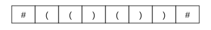

When `)` is under the head, it changes to `LookForOpen`, writes `X` and moves
the head left, and it keeps moving left while it sees `X`.

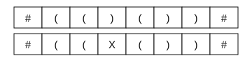

When `(` is under the head, it changes to `LookForClosing`, writes `X` and
moves the head right, and it keeps moving right while it sees `X` or `)`.

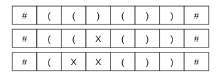

The process continues, matching parentheses and switching between
`LookForClosing` and `LookForOpen`.

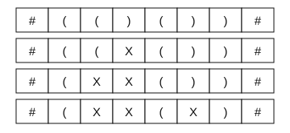
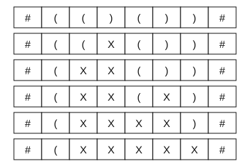

After the last `(` is rewritten, the TM is in `LookForClosing`. It goes right
until it finds `#`, changes to `CheckTape`, and starts moving left while it
sees `X`.

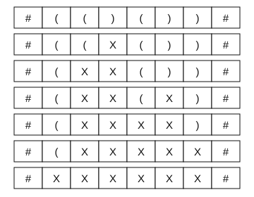

When the TM finds `#` while in `CheckTape`, it overwrites it with a `1`,
which means accept, and halts.

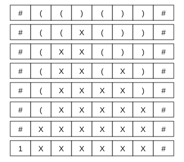

Watch what the machine is doing with its tape: it is using it as memory. The
`X`s record which parentheses have already been matched, information that a
finite automaton has no way to store, and that is the whole difference.

A *nondeterministic Turing machine* has the transition function $\delta: Q
\times \Gamma \rightarrow \mathcal{P}(Q \times \Gamma \times \{L,R,N\})$, so a
combination of state and tape symbol can lead to more than one triple of
state, symbol and action. All paths happen in parallel, or, equivalently, the
TM takes the smartest path towards accepting. The input is accepted if any
path leads to an accepting state, and rejected if all paths lead to a
rejecting state or are infinite. This is a thought device, not a buildable
machine; its value comes in section 9, where it gives the cleanest
definition of the class NP.

Alan Mathison Turing (1912–1954) designed the TM to formalize algorithms. He
defined computation as the set of problems that can be solved by algorithms
and found examples of problems that cannot be computed. He is famous for his
work during the Second World War to crack the Enigma code with an
electromechanical machine called the Bombe, and he was among the first to
work on artificial intelligence: the Turing test proposes to define AI as
machines able to pass as human a given percentage of the time when chatting
with people. He died in 1954, by suicide according to the inquest, two years
after being prosecuted for his homosexuality and forced to undergo hormone
treatment.

---

## 7. Computability

Recall from session 5 that an algorithm is a self-contained, step-by-step set
of operations to solve a given problem, and that algorithms always
terminate: for correct inputs, the algorithm must always terminate in a
finite number of steps. A problem is *computable* if there exists an
algorithm that solves it, and if we can prove that no algorithm can solve a
problem in finite time, the problem is *noncomputable*. Up to now our
definition of algorithm has been intuitive: we can tell what is an algorithm
and what is not, but we lack a mathematical definition. Alonzo Church and
Alan Turing worked in parallel to formalize it, Church with the lambda
calculus and Turing with his machines, and reached equivalent definitions,
which is the *Church-Turing thesis*: an algorithm is what can be computed by
a Turing machine. It is a thesis and not a theorem, a statement from which
the rest of computer science is derived but which has no formal proof. It
cannot have one, because it equates a formal object, the TM, with an
informal one, our intuition of an algorithm. Its support is that every model
of computation anyone has proposed in ninety years has turned out to be
equivalent to a TM or weaker.

### A noncomputable problem: the halting problem

The *halting problem* takes as input a string representing a program, for
example in Python, and outputs `True` if evaluating the input program would
ever finish and `False` otherwise. Assume that `halts(X)` is an algorithm
that solves it, where `X` is the Python code given as input, so that
`halts(X)` returns `True` if evaluating `X` would finish in finite time and
`False` otherwise:

```python
halts('(2 + 3)')            # True
halts('while True: pass')   # False
```

That looks reasonable so far, but consider

```python
halts('n = 4;
       while sumOfTwoPrimes(n):
           n = n + 2')      # = ?
```

This program halts exactly when it finds an even number that is not the sum
of two primes, that is, exactly when Goldbach's conjecture is false.
Answering it would settle a 280-year-old open problem in mathematics, which
is a hint that `halts` cannot exist. The proof is by contradiction: if we
assume that `halts(X)` exists, the following is a legitimate program,

```python
def paradox():
    if halts('paradox()'):
        while True:
            pass
```

and we can ask what `halts('paradox()')` returns. If it returns `True`, the
program enters an infinite loop, so it does not halt, and `halts('paradox()')`
cannot be `True`. If it returns `False`, the program skips the loop and
terminates, so it does halt, and `halts('paradox()')` cannot be `False`.
Since it has to be one or the other, `halts(X)` cannot exist. Notice what
this argument used: only the ability to write a program that calls `halts` on
its own source. Your knowledge of Python is a model of computing, and the
proof above is a complete and rigorous proof phrased in Python instead of in
Turing machines; Turing showed the same thing for TMs as a general model of
computing, which is what makes the result universal rather than a quirk of
Python. The halting problem is not an isolated curiosity. By similar
arguments, any non-trivial question about the behavior of arbitrary programs
is undecidable, a result known as Rice's theorem, and this is why perfect
static analysis, perfect virus detection and perfect automated bug finding
are impossible in principle, not merely hard.

---

## 8. Universal machines and Turing completeness

Turing machines can be encoded with finite codes, for example a state list, a
transition table and an alphabet. A *universal Turing machine* simulates a TM
whose code is written on its tape, followed by the input of that TM; the
universal TM then writes the output of the simulated TM and stops if the
simulated TM stops. This is the theoretical statement of the idea of session
1, a machine that runs a changeable program: hardware and software are the
same kind of thing, and a program is data. A model of computation, whether a
machine model or a programming language, is *Turing complete* if it can be
used to simulate a universal Turing machine, and Turing complete models can
execute any algorithm. Python is Turing complete, because you can write
Python code that simulates any Turing machine and thus, by definition, can
execute any algorithm. In practice you code algorithms directly in Python
without simulating a TM; the point is that you can, not that it is easy,
understandable or efficient.

The lecture gives two families of examples. *Cellular automata* are models
of computation in which cells change state according to extremely simple
rules; structures emerge that, when interacting, can be set up to simulate
any TM, and Conway's Game of Life and rule 110 are the standard examples.
Games can be used in the same way: Minecraft and Magic: The Gathering
(Churchill, Biderman & Herrick, 2019) can simulate a universal Turing
machine, and Sokoban puzzles can simulate any Turing machine with a bounded
tape, which is what Culberson (1997) showed by proving that Sokoban is
PSPACE-complete. The point of these examples is not that they are useful. It
is that Turing completeness is easy to achieve accidentally, since a handful
of rules is often enough, and that once a system is Turing complete, the
halting problem applies to it: you cannot in general predict what a Magic
deck will do.

---

## 9. Complexity classes

In terms of a TM, *time complexity* is the number of transitions the TM has
to make to reach a final state, and for a nondeterministic TM it is the
maximum depth among all execution branches. Recall the ordering of O-classes
from session 8,

$$O(1) \subset O(\log n) \subset O(n) \subset O(n\log n) \subset O(n^2) \subset O(2^n) \subset O(n!).$$

We can talk about the complexity of a *problem* in terms of the time
complexity of the known algorithms to solve it. This defines a hierarchy:
inefficient algorithms with long running times can be written for almost any
problem, but some problems might not be solvable with faster ones, and we
define sets of problems as *complexity classes* that relate problems to the
time complexity of the algorithms that can solve them. The theory is stated
for *decision problems*, which have a binary output, true or false. Decision
problems can be very general; determining whether a word belongs to a
language is a decision problem, and most questions can be rephrased as one,
for example "is there a route shorter than $k$?" instead of "what is the
shortest route?".

### The class P

The class P contains all decision problems that can be solved by a
deterministic Turing machine using a polynomial amount of computation steps.
In other words, for each problem in P there is at least one algorithm that
decides its output in a number of steps that grows polynomially with the
input size, such as $O(n)$, $O(n^2)$ or $O(n^{99})$, and also subpolynomially,
since $O(\log n) \subset O(n)$. An example of a problem in P is deciding
whether there is a path between two vertices of a graph: you can run DFS on
the graph to find the path, and since DFS runs in $O(|V|+|E|)$, the problem
belongs to P. P is the usual formalization of "efficiently solvable". It is
imperfect, because $O(n^{99})$ is polynomial and useless, but it is robust:
it does not change if you switch machine models, which is exactly the
property a definition in theory needs.

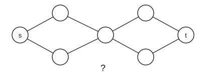

### Verifiers and the class NP

After solving a problem, you can *verify* whether the solution is correct. A
*verifier* is an algorithm, that is, a TM, that takes two inputs, a
description or encoding of a problem $p$ and a candidate solution $c$, and
returns `True` if $c$ is a solution of $p$ and `False` otherwise. The
candidate $c$ is also called a *certificate* or *proof* that $p$ has a
solution, and verifying a solution is always a decision problem. For the
problem of finding a path between $s$ and $t$ in $G$, the input tape of the
verifier holds the problem, that is, the vertex list, the edge list and the
indices $s$ and $t$, followed by the certificate, a sequence of nodes.

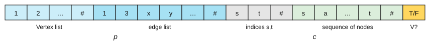

The class NP is the set of decision problems for which positive instances,
those whose answer is `True`, have proofs verifiable in polynomial time by a
deterministic Turing machine. An equivalent definition is the set of
decision problems solvable in polynomial time by a nondeterministic Turing
machine, which "guesses" the proof by branching and then verifies it
deterministically. NP stands for nondeterministic polynomial time; it does
not stand for "not polynomial".

The example of the lecture is the Hamiltonian path. A *Hamiltonian path* is a
path in a graph that visits each vertex exactly once, where the edges in the
path sequence have to be distinct, and the decision problem is whether $G$
has a Hamiltonian path, also phrased as whether $G$ is traceable. Verifying
that a given path is Hamiltonian can be done in $O(|V|+|E|)$, by walking it
and ticking off the vertices, so the problem is in NP. But finding one is not
easy: no known algorithm finds a Hamiltonian path in polynomial time, and the
known algorithms are essentially brute force, trying all combinations in
$O(|V|!)$. That asymmetry, easy to check and hard to find, is the entire
subject of P versus NP.

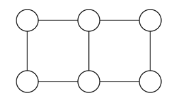
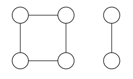

### P versus NP

All problems in P are also in NP, because if you can decide a problem in
polynomial time you can verify it in polynomial time. Verifying in
polynomial time does not imply deciding in polynomial time, as far as anyone
knows, and this is based on the algorithms currently known: an NP problem
becomes a P problem the moment someone invents a polynomial-time algorithm
for it. Proving that P = NP or that P ≠ NP is arguably the most important
open question in computer science, and it is one of the Clay Millennium
Problems, with a prize of one million dollars.

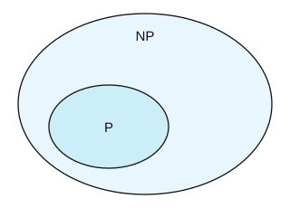

### Reducing problems

*Reducing* a decision problem A to another decision problem B means finding a
function $f$ that maps all inputs of A with output `True` to inputs of B with
output `True`, and all inputs of A with output `False` to inputs of B with
output `False`. An algorithm that solves B can then be used to solve A. If
$f$ can be applied in polynomial time, we say that A is *polynomial-time
reducible* to B, and in that case, if B is in P, then A is in P too.
Reduction is how complexity theory transfers knowledge between problems, and
it is the same move as in mathematics: I can solve this because I already
solved that.

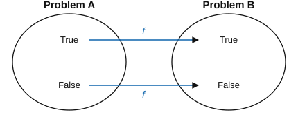

### NP-complete and NP-hard problems

Some NP problems can be reduced in polynomial time to other NP problems. This
determines a network between problems: if we find a polynomial-time
algorithm that solves one problem, we solve every problem that can be reduced
to it. Some special NP problems have the property that any other NP problem
can be reduced to them, and a problem is *NP-complete* if it belongs to NP
and every other NP problem is polynomial-time reducible to it.

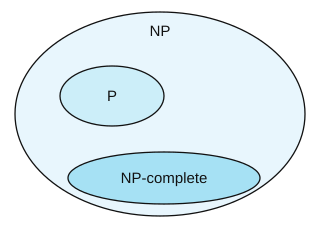

The original NP-complete problem is boolean satisfiability, SAT. Boolean
formulas in propositional logic use three operations, AND ($\wedge$), OR
($\vee$) and negation ($\bar{x}$), over variables that can take the value
True (1) or False (0), and SAT takes a boolean formula as input and returns
`True` if and only if there is some assignment of the variables for which
the formula is true. For example,

$$(x_1 \vee x_2 \vee x_3 \vee \bar{x}_4) \wedge (\bar{x}_3 \vee x_5 \vee \bar{x}_6) \wedge (x_3 \vee \bar{x}_6)$$

is satisfiable with $x_1 = x_2 = x_4 = x_5 = $ True and $x_3 = x_6 = $ False,
while

$$(x_1 \vee x_2) \wedge (\bar{x}_1 \vee x_2) \wedge (x_1 \vee \bar{x}_2) \wedge (\bar{x}_1 \vee \bar{x}_2)$$

is not satisfiable, because the four clauses rule out the four possible
assignments. Any NP problem can be reduced to SAT, which makes it the
original NP-complete problem. The Cook-Levin theorem shows why: finding a
halting execution of any nondeterministic TM can be reformulated as
satisfying a logical formula. If you find a polynomial-time algorithm for
SAT, then P = NP, and you earn the million dollars.

Finally, a problem is *NP-hard* if every NP problem is polynomial-time
reducible to it. NP-hard problems do not have to be in NP, and they do not
even have to be decision problems; informally, they are at least as hard as
the hardest problems in NP. The term is often used to convey the lack of
polynomial-time algorithms for problems that are not decision problems, for
example finding, rather than detecting, a Hamiltonian path in a graph. The
distinction matters in practice: when a paper says that your problem is
NP-hard, it is telling you to stop looking for an exact efficient algorithm
and to start looking for approximations, heuristics, or a restricted version
of the problem that is tractable.

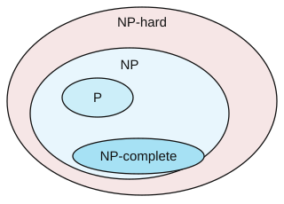

---

## 10. Summary

Turing machines are the most general model of a computer we have seen, and
they recognize grammars without restrictions. Regarding computability, the
Church-Turing thesis says that algorithms are what Turing machines compute,
some problems cannot be computed, the halting problem being the example, and
a model of computation that can simulate a TM is Turing complete. Regarding
complexity classes, P is the class of decision problems solvable in
polynomial time, NP the class of problems with proofs verifiable in
polynomial time, polynomial-time reducibility relates problems to each
other, NP-complete problems are the ones to which every NP problem reduces,
which ties them to the P versus NP question, and NP-hard problems are
general problems without known efficient algorithms.

---

## 11. Check yourself

**1.** Why can no DFA recognize "strings with an equal number of a's and b's"?

<details><summary>Answer</summary>

Because it would need to remember the running difference between the counts,
and that difference is unbounded while $Q$ is finite. Formally this is proved
with the pumping lemma. Note the contrast with the automaton of section 2,
which tracks the difference modulo 4, a finite amount of information, and is
therefore fine.

</details>

**2.** NFAs are no more powerful than DFAs. So why use them?

<details><summary>Answer</summary>

Convenience. An NFA for "contains the substring ICSS" is trivial to write,
by guessing where the substring starts, while the equivalent DFA has to track
partial matches explicitly. Since the conversion is mechanical, you design
with the easy model and let a tool produce the efficient one. This is also
how regular expression engines work internally.

</details>

**3.** Someone claims to have written a program that detects infinite loops in any Python program. What do you say?

<details><summary>Answer</summary>

That it cannot be correct in general, because that is exactly the halting
problem. It may well be a useful heuristic that catches common cases, and
such tools exist, but it must either fail to answer for some inputs, or answer
wrongly for some. Ask which.

</details>

**4.** Your research problem turns out to be NP-hard. Is your project dead?

<details><summary>Answer</summary>

No, but the goal has to change. The options are to solve small instances
exactly, to use an approximation algorithm with a proven bound, to use a
heuristic and validate it empirically, to restrict the problem, since many
NP-hard graph problems are easy on trees or planar graphs, or to reformulate
it as a problem you can solve. What you should not do is keep looking for an
exact, efficient, general algorithm.

</details>

**5.** If someone proved P = NP tomorrow, what would change?

<details><summary>Answer</summary>

In principle, enormously: efficient algorithms would exist for thousands of
problems currently considered intractable, such as scheduling, protein
folding and optimization of every kind, and most public-key cryptography
would be broken, since its security rests on certain problems being hard. In
practice it would depend on the proof: a non-constructive proof, or one
giving an $O(n^{100})$ algorithm, would change the theory and nothing else.
Most researchers expect P ≠ NP.

</details>

---

## 12. References

- **Sipser, M. (2012).** *Introduction to the Theory of Computation*, 3rd ed.
  Cengage. Chapter 1 (regular languages) is the reading for this session;
  chapters 3 and 4 cover Turing machines and decidability, and chapter 7 the
  complexity classes.
- **Evans, D. (2011).** *Introduction to Computing: Explorations in Language,
  Logic, and Machines*. <https://computingbook.org/>. Chapter 6 for Turing
  machines and chapter 12 for computability; the parenthesis-checking machine
  of section 6 is his.
- **Cormen, T. H. (2013).** *Algorithms Unlocked*, chapter 10 ("Hard?
  Problems").
- **Turing, A. M. (1936).** "On Computable Numbers, with an Application to
  the Entscheidungsproblem". *Proceedings of the London Mathematical Society*,
  series 2, 42, 230–265. The machine, and the halting problem.
- **Rabin, M. O. & Scott, D. (1959).** "Finite Automata and Their Decision
  Problems". *IBM Journal of Research and Development* 3(2), 114–125. The
  NFA/DFA equivalence theorem.
- **Chomsky, N. (1956).** "Three models for the description of language".
  *IRE Transactions on Information Theory* 2(3), 113–124. The hierarchy.
- **Cook, S. A. (1971).** "The complexity of theorem-proving procedures".
  *Proceedings of the Third Annual ACM Symposium on Theory of Computing*,
  151–158. The Cook-Levin theorem and NP-completeness.
- **Clay Mathematics Institute.** *P vs NP Problem*.
  <https://www.claymath.org/millennium-problems/p-vs-np-problem>
- **Churchill, A., Biderman, S. & Herrick, A. (2019).** "Magic: The Gathering
  is Turing Complete". *arXiv:1904.09828*.
- **Culberson, J. (1997).** "Sokoban is PSPACE-complete". Technical report
  TR 97-02, University of Alberta.
- **Bairagi, S.** *Emulating Pac-Man using Finite State Machines*. Bachelor
  thesis, IIIT Ranchi. The Pac-Man DFA in the slides.
- **XKCD 208**, *Regular Expressions*: <https://xkcd.com/208/>
